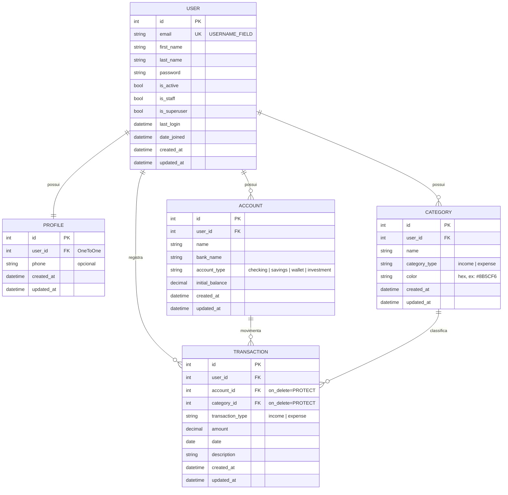

# PRD — Finanpy

> Product Requirement Document do sistema de gestão de finanças pessoais **Finanpy**.

---

## 1. Visão geral

O **Finanpy** é um sistema web de gestão de finanças pessoais, desenvolvido em Python com Django full stack. Ele permite que o usuário cadastre suas contas bancárias, organize suas movimentações financeiras por categorias e acompanhe entradas, saídas e saldos em um dashboard único.

O projeto é intencionalmente simples e enxuto: sem over engineering, usando apenas recursos nativos do Django, Django Template Language (DTL) com TailwindCSS no frontend e SQLite como banco de dados.

---

## 2. Sobre o produto

O Finanpy é composto por duas áreas:

1. **Site público de apresentação (landing page):** apresenta o produto e oferece as opções **Cadastre-se** e **Entrar**.
2. **Área autenticada:** após o login (feito por e-mail e senha), o usuário é direcionado ao **dashboard**, de onde acessa:
   - Contas bancárias
   - Categorias
   - Transações (entradas e saídas)
   - Perfil

Toda a interface é em **português brasileiro**, com design moderno, responsivo, fundo escuro e gradientes de cores harmônicas, seguindo um design system único em todas as telas.

---

## 3. Propósito

Oferecer uma ferramenta simples, rápida e visualmente agradável para que pessoas físicas controlem o próprio dinheiro: saber quanto têm, de onde vem e para onde vai cada real, sem a complexidade de planilhas ou aplicativos sobrecarregados de funcionalidades.

---

## 4. Público alvo

- Pessoas físicas que desejam organizar suas finanças pessoais.
- Usuários que possuem uma ou mais contas bancárias e querem uma visão consolidada dos saldos.
- Pessoas que hoje usam planilhas ou anotações e buscam algo mais prático.
- Perfil de uso: desktop e mobile (navegador), com conhecimento básico de internet.

---

## 5. Objetivos

1. Permitir o cadastro e login de usuários utilizando **e-mail** como identificador.
2. Permitir o gerenciamento (CRUD) de **contas bancárias**.
3. Permitir o gerenciamento (CRUD) de **categorias** de entradas e saídas.
4. Permitir o registro (CRUD) de **transações** de entrada e saída, vinculadas a uma conta e a uma categoria.
5. Exibir um **dashboard** com saldo total, total de entradas e saídas do mês e últimas transações.
6. Garantir que cada usuário acesse **somente os próprios dados**.
7. Manter uma **identidade visual consistente** em todo o sistema.
8. Manter o código **simples**, em inglês, seguindo a PEP 8 e usando aspas simples.

---

## 6. Requisitos funcionais

### 6.1 Site público

| ID   | Requisito                                                                                        |
| ---- | ------------------------------------------------------------------------------------------------ |
| RF01 | O sistema deve exibir uma landing page pública apresentando o Finanpy.                           |
| RF02 | A landing page deve conter os botões **Cadastre-se** e **Entrar**.                               |
| RF03 | Usuários já autenticados que acessarem a landing page devem ver o botão **Ir para o dashboard**. |

### 6.2 Usuários e autenticação

| ID   | Requisito                                                                                                          |
| ---- | ------------------------------------------------------------------------------------------------------------------ |
| RF04 | O usuário deve poder se cadastrar informando nome, sobrenome, e-mail e senha (com confirmação).                    |
| RF05 | O e-mail deve ser único no sistema.                                                                                |
| RF06 | O login deve ser realizado com **e-mail e senha** (não com username).                                              |
| RF07 | Após o cadastro, o usuário deve ser autenticado automaticamente e redirecionado ao dashboard.                      |
| RF08 | Após o login, o usuário deve ser redirecionado ao dashboard.                                                       |
| RF09 | O usuário deve poder sair do sistema (logout), sendo redirecionado à landing page.                                 |
| RF10 | Páginas da área autenticada devem exigir login; usuários não autenticados são redirecionados para a tela de login. |

### 6.3 Perfil

| ID   | Requisito                                                                                   |
| ---- | ------------------------------------------------------------------------------------------- |
| RF11 | Um perfil deve ser criado automaticamente quando um usuário é cadastrado.                   |
| RF12 | O usuário deve poder visualizar e editar seus dados de perfil (nome, sobrenome e telefone). |

### 6.4 Contas bancárias

| ID   | Requisito                                                                                     |
| ---- | --------------------------------------------------------------------------------------------- |
| RF13 | O usuário deve poder cadastrar contas bancárias (nome, banco, tipo de conta e saldo inicial). |
| RF14 | O usuário deve poder listar, editar e excluir suas contas.                                    |
| RF15 | O sistema deve exibir o saldo atual de cada conta (saldo inicial + entradas − saídas).        |
| RF16 | Tipos de conta disponíveis: Conta corrente, Poupança, Carteira e Investimento.                |

### 6.5 Categorias

| ID   | Requisito                                                                                            |
| ---- | ---------------------------------------------------------------------------------------------------- |
| RF17 | O usuário deve poder cadastrar categorias informando nome, tipo (Entrada ou Saída) e cor.            |
| RF18 | O usuário deve poder listar, editar e excluir suas categorias.                                       |
| RF19 | Uma categoria vinculada a transações não pode ser excluída (o sistema deve exibir mensagem de erro). |

### 6.6 Transações

| ID   | Requisito                                                                                                             |
| ---- | --------------------------------------------------------------------------------------------------------------------- |
| RF20 | O usuário deve poder registrar transações informando tipo (Entrada/Saída), valor, data, descrição, conta e categoria. |
| RF21 | O usuário deve poder listar, editar e excluir suas transações.                                                        |
| RF22 | A listagem de transações deve ser ordenada da mais recente para a mais antiga e paginada.                             |
| RF23 | A listagem deve permitir filtro por período (data inicial e final), tipo, conta e categoria.                          |
| RF24 | Nos formulários, apenas contas e categorias do próprio usuário devem ser exibidas.                                    |
| RF25 | A categoria escolhida deve ser do mesmo tipo da transação (Entrada/Saída).                                            |
| RF26 | Uma conta vinculada a transações não pode ser excluída (o sistema deve exibir mensagem de erro).                      |

### 6.7 Dashboard

| ID   | Requisito                                                                |
| ---- | ------------------------------------------------------------------------ |
| RF27 | O dashboard deve exibir o saldo total consolidado de todas as contas.    |
| RF28 | O dashboard deve exibir o total de entradas e de saídas do mês corrente. |
| RF29 | O dashboard deve exibir o resultado do mês (entradas − saídas).          |
| RF30 | O dashboard deve exibir as 5 últimas transações.                         |
| RF31 | O dashboard deve exibir a lista de contas com seus saldos.               |

### 6.8 Mensagens de feedback

| ID   | Requisito                                                                                                     |
| ---- | ------------------------------------------------------------------------------------------------------------- |
| RF32 | Toda ação de criar, editar e excluir deve exibir uma mensagem de sucesso ou erro (Django messages framework). |

### 6.9 Flowchart dos fluxos de UX


---

## 7. Requisitos não-funcionais

| ID    | Requisito                                                                                                                       |
| ----- | ------------------------------------------------------------------------------------------------------------------------------- |
| RNF01 | Backend e frontend em **Django full stack**, com templates em Django Template Language.                                         |
| RNF02 | Estilização exclusivamente com **TailwindCSS**.                                                                                 |
| RNF03 | Interface **responsiva** (mobile, tablet e desktop), com fundo escuro e gradientes.                                             |
| RNF04 | Toda a interface exibida ao usuário em **português brasileiro** (`LANGUAGE_CODE = 'pt-br'`, `TIME_ZONE = 'America/Sao_Paulo'`). |
| RNF05 | Todo o código (variáveis, funções, classes, models, URLs) em **inglês**.                                                        |
| RNF06 | Código seguindo a **PEP 8** e usando **aspas simples** sempre que possível.                                                     |
| RNF07 | Banco de dados **SQLite** padrão do Django.                                                                                     |
| RNF08 | Todo model deve possuir os campos `created_at` e `updated_at`.                                                                  |
| RNF09 | Uso preferencial de **Class Based Views** e recursos nativos do Django.                                                         |
| RNF10 | Signals, quando usados, ficam em `signals.py` dentro da app correspondente.                                                     |
| RNF11 | Autenticação com o sistema nativo do Django (`django.contrib.auth`), com login por e-mail.                                      |
| RNF12 | Isolamento de dados: todas as queries da área autenticada filtradas pelo usuário logado.                                        |
| RNF13 | Proteção CSRF em todos os formulários (nativa do Django).                                                                       |
| RNF14 | Senhas validadas pelos `AUTH_PASSWORD_VALIDATORS` nativos do Django.                                                            |
| RNF15 | Valores monetários armazenados em `DecimalField` e exibidos no formato brasileiro (R$ 1.234,56).                                |
| RNF16 | Testes automatizados e Docker ficam para as sprints finais.                                                                     |

---

## 8. Arquitetura técnica

### 8.1 Stack

| Camada                    | Tecnologia                                                                |
| ------------------------- | ------------------------------------------------------------------------- |
| Linguagem                 | Python 3.12+                                                              |
| Framework                 | Django 5.x                                                                |
| Templates                 | Django Template Language                                                  |
| Estilos                   | TailwindCSS (CLI standalone, sem Node.js)                                 |
| Banco de dados            | SQLite                                                                    |
| Autenticação              | `django.contrib.auth` com model de usuário customizado (login por e-mail) |
| Mensagens                 | `django.contrib.messages`                                                 |
| Formatação BR             | `django.contrib.humanize` + localização nativa (`USE_L10N`/`pt-br`)       |
| Containers (sprint final) | Docker + docker-compose                                                   |
| Testes (sprint final)     | `django.test` (TestCase nativo)                                           |

### 8.2 Estrutura de diretórios

```
finanpy
├── accounts          # contas bancárias
├── categories        # categorias de lançamentos/transações
├── core              # configurações globais, landing page e dashboard
├── profiles          # perfis de usuários (+ signals.py)
├── transactions      # transações - entradas e saídas
├── users             # usuário customizado (login por e-mail)
├── templates         # templates globais (base, componentes, landing)
│   ├── base.html
│   ├── base_auth.html
│   ├── components/
│   └── ...
├── static
│   ├── css/input.css
│   └── css/output.css
├── db.sqlite3
└── manage.py
```

Cada app possui sua própria pasta `templates/<app>/` para os templates específicos, além de `urls.py` e `forms.py` quando necessário.

### 8.3 Responsabilidade das apps

| App            | Responsabilidade                                                                  |
| -------------- | --------------------------------------------------------------------------------- |
| `core`         | settings, URLs raiz, landing page (`HomeView`) e dashboard (`DashboardView`)      |
| `users`        | model `User` customizado (e-mail como `USERNAME_FIELD`), cadastro, login e logout |
| `profiles`     | model `Profile`, signal de criação automática e edição de perfil                  |
| `accounts`     | model `Account` e CRUD de contas                                                  |
| `categories`   | model `Category` e CRUD de categorias                                             |
| `transactions` | model `Transaction`, CRUD e filtros                                               |

### 8.4 Estrutura de dados (schemas)



**Observações de modelagem:**

- `User` herda de `AbstractUser`, remove o campo `username`, define `email` como único e `USERNAME_FIELD = 'email'`, com um `UserManager` customizado.
- O saldo atual da conta **não é armazenado**: é calculado (`initial_balance + soma de entradas − soma de saídas`) via método/propriedade no model, evitando inconsistências.
- `account` e `category` em `Transaction` usam `on_delete=models.PROTECT`, impedindo exclusão de registros em uso.
- `Category` possui `unique_together` (ou `UniqueConstraint`) em `(user, name, category_type)`.
- `amount` e `initial_balance` usam `DecimalField(max_digits=12, decimal_places=2)`; `amount` deve ser maior que zero.
- `created_at = models.DateTimeField(auto_now_add=True)` e `updated_at = models.DateTimeField(auto_now=True)` em todos os models.

---

## 9. Design system

Todo o visual é construído com classes utilitárias do TailwindCSS dentro dos templates DTL. Componentes reutilizáveis ficam em `templates/components/` e são incluídos com ``.

### 9.1 Princípios

- **Fundo escuro** como base, com superfícies levemente mais claras para criar profundidade.
- **Gradiente de marca** (violeta → índigo → ciano) aplicado em destaques: logo, botões primários, títulos de hero e cards de destaque.
- **Cores semânticas** consistentes: verde para entradas, vermelho/rosa para saídas.
- **Cantos arredondados**, bordas sutis e sombras suaves.
- **Mobile first**: todo layout começa em uma coluna e expande em breakpoints `md` e `lg`.

### 9.2 Paleta de cores

| Token              | Uso                         | Classe Tailwind             | Hex                   |
| ------------------ | --------------------------- | --------------------------- | --------------------- |
| Fundo da página    | `body`                      | `bg-slate-950`              | `#020617`             |
| Superfície         | cards, sidebar, navbar      | `bg-slate-900`              | `#0F172A`             |
| Superfície elevada | inputs, hover de itens      | `bg-slate-800`              | `#1E293B`             |
| Borda              | divisórias e contornos      | `border-slate-700/50`       | `#334155`             |
| Texto principal    | títulos e valores           | `text-slate-100`            | `#F1F5F9`             |
| Texto secundário   | descrições e labels         | `text-slate-400`            | `#94A3B8`             |
| Primária           | ações e foco                | `violet-500` / `violet-600` | `#8B5CF6` / `#7C3AED` |
| Secundária         | apoio do gradiente          | `indigo-500`                | `#6366F1`             |
| Acento             | apoio do gradiente          | `cyan-400`                  | `#22D3EE`             |
| Entrada (sucesso)  | valores positivos           | `emerald-400`               | `#34D399`             |
| Saída (perigo)     | valores negativos, exclusão | `rose-400` / `rose-600`     | `#FB7185` / `#E11D48` |
| Alerta             | avisos                      | `amber-400`                 | `#FBBF24`             |

**Gradientes:**

| Nome                      | Classes                                                                                     |
| ------------------------- | ------------------------------------------------------------------------------------------- |
| Gradiente de marca        | `bg-gradient-to-r from-violet-600 via-indigo-500 to-cyan-400`                               |
| Gradiente de texto        | `bg-gradient-to-r from-violet-400 via-indigo-400 to-cyan-300 bg-clip-text text-transparent` |
| Gradiente de fundo (hero) | `bg-gradient-to-br from-slate-950 via-indigo-950 to-slate-950`                              |
| Card de entrada           | `bg-gradient-to-br from-emerald-500/20 to-emerald-500/5`                                    |
| Card de saída             | `bg-gradient-to-br from-rose-500/20 to-rose-500/5`                                          |

### 9.3 Tipografia

- **Fonte:** `Inter` (Google Fonts), com fallback `ui-sans-serif, system-ui, sans-serif`, configurada como `font-sans` no tema do Tailwind.
- **Valores monetários:** `tabular-nums` para alinhar dígitos.

| Elemento              | Classes                                                      |
| --------------------- | ------------------------------------------------------------ |
| Título da página (h1) | `text-2xl md:text-3xl font-bold text-slate-100`              |
| Título de seção (h2)  | `text-xl font-semibold text-slate-100`                       |
| Título de card (h3)   | `text-sm font-medium text-slate-400 uppercase tracking-wide` |
| Valor de destaque     | `text-2xl md:text-3xl font-bold tabular-nums`                |
| Texto padrão          | `text-sm text-slate-300`                                     |
| Texto auxiliar        | `text-xs text-slate-500`                                     |
| Título hero (landing) | `text-4xl md:text-6xl font-extrabold` + gradiente de texto   |

### 9.4 Botões

Base comum: `inline-flex items-center justify-center gap-2 rounded-xl px-4 py-2.5 text-sm font-semibold transition focus:outline-none focus:ring-2 focus:ring-violet-500 focus:ring-offset-2 focus:ring-offset-slate-950`

| Variante   | Classes adicionais                                                                                                       | Uso                      |
| ---------- | ------------------------------------------------------------------------------------------------------------------------ | ------------------------ |
| Primário   | `bg-gradient-to-r from-violet-600 via-indigo-500 to-cyan-400 text-white shadow-lg shadow-violet-900/30 hover:opacity-90` | Salvar, criar, entrar    |
| Secundário | `bg-slate-800 text-slate-100 border border-slate-700 hover:bg-slate-700`                                                 | Cancelar, voltar         |
| Perigo     | `bg-rose-600 text-white hover:bg-rose-500`                                                                               | Confirmar exclusão       |
| Ghost      | `text-slate-300 hover:text-white hover:bg-slate-800`                                                                     | Ações de tabela, links   |
| Ícone      | `p-2 rounded-lg text-slate-400 hover:text-white hover:bg-slate-800`                                                      | Editar/excluir em linhas |

### 9.5 Inputs e forms

| Elemento                  | Classes                                                                                                                                                                                    |
| ------------------------- | ------------------------------------------------------------------------------------------------------------------------------------------------------------------------------------------ |
| Label                     | `block text-sm font-medium text-slate-300 mb-1.5`                                                                                                                                          |
| Input / select / textarea | `w-full rounded-xl bg-slate-800 border border-slate-700 px-4 py-2.5 text-slate-100 placeholder-slate-500 focus:border-violet-500 focus:ring-2 focus:ring-violet-500/40 focus:outline-none` |
| Input com erro            | adicionar `border-rose-500 focus:ring-rose-500/40`                                                                                                                                         |
| Mensagem de erro          | `mt-1 text-xs text-rose-400`                                                                                                                                                               |
| Texto de ajuda            | `mt-1 text-xs text-slate-500`                                                                                                                                                              |
| Container do form         | `bg-slate-900 border border-slate-700/50 rounded-2xl p-6 md:p-8 space-y-5`                                                                                                                 |
| Rodapé do form            | `flex flex-col-reverse sm:flex-row sm:justify-end gap-3 pt-4`                                                                                                                              |

As classes dos inputs são aplicadas nos `widgets` dos forms Django (atributo `attrs={'class': ...}`), centralizadas em um mixin/constante reutilizável para não repetir strings. Os campos são renderizados pelo componente `components/form_field.html`.

### 9.6 Cards

| Elemento                       | Classes                                                                                                             |
| ------------------------------ | ------------------------------------------------------------------------------------------------------------------- |
| Card padrão                    | `bg-slate-900 border border-slate-700/50 rounded-2xl p-6 shadow-xl shadow-black/20`                                 |
| Card de métrica (KPI)          | card padrão + gradiente semântico e ícone                                                                           |
| Card de destaque (saldo total) | `rounded-2xl p-6 bg-gradient-to-br from-violet-600/30 via-indigo-600/20 to-cyan-500/10 border border-violet-500/30` |

### 9.7 Grids e layout

| Contexto             | Classes                                                            |
| -------------------- | ------------------------------------------------------------------ |
| Container da página  | `max-w-7xl mx-auto px-4 sm:px-6 lg:px-8 py-6`                      |
| Grid de KPIs         | `grid grid-cols-1 sm:grid-cols-2 lg:grid-cols-4 gap-4`             |
| Grid de duas colunas | `grid grid-cols-1 lg:grid-cols-3 gap-6` (conteúdo `lg:col-span-2`) |
| Grid de formulário   | `grid grid-cols-1 md:grid-cols-2 gap-5`                            |
| Layout autenticado   | sidebar fixa à esquerda (`lg:w-64`) + conteúdo `flex-1`            |

### 9.8 Menus e navegação

- **Navbar pública (landing):** `sticky top-0 backdrop-blur bg-slate-950/70 border-b border-slate-800`; logo com gradiente à esquerda; botões **Entrar** (ghost) e **Cadastre-se** (primário) à direita.
- **Sidebar autenticada (desktop, `lg+`):** `bg-slate-900 border-r border-slate-800`, itens:
  - Dashboard, Contas, Categorias, Transações, Perfil, Sair.
  - Item padrão: `flex items-center gap-3 px-4 py-2.5 rounded-xl text-slate-400 hover:text-white hover:bg-slate-800`
  - Item ativo: `bg-gradient-to-r from-violet-600/20 to-transparent text-white border-l-2 border-violet-500`
- **Menu mobile:** topbar com botão hambúrguer que abre/fecha a sidebar (toggle com poucas linhas de JavaScript puro, sem bibliotecas).

### 9.9 Tabelas e listas

| Elemento         | Classes                                                                                         |
| ---------------- | ----------------------------------------------------------------------------------------------- |
| Wrapper          | `overflow-x-auto rounded-2xl border border-slate-700/50`                                        |
| Tabela           | `min-w-full divide-y divide-slate-800 text-sm`                                                  |
| Cabeçalho        | `bg-slate-900 text-left text-xs font-semibold uppercase tracking-wide text-slate-400 px-4 py-3` |
| Linha            | `bg-slate-900/50 hover:bg-slate-800/60 transition`                                              |
| Célula           | `px-4 py-3 text-slate-300`                                                                      |
| Valor de entrada | `text-emerald-400 font-semibold tabular-nums` (prefixo `+`)                                     |
| Valor de saída   | `text-rose-400 font-semibold tabular-nums` (prefixo `−`)                                        |

No mobile, listas longas podem ser exibidas como cards empilhados em vez de tabela (`hidden md:table` / `md:hidden`).

### 9.10 Badges, alertas e estados

| Elemento           | Classes                                                                                         |
| ------------------ | ----------------------------------------------------------------------------------------------- |
| Badge entrada      | `inline-flex px-2.5 py-0.5 rounded-full text-xs font-medium bg-emerald-500/15 text-emerald-400` |
| Badge saída        | `inline-flex px-2.5 py-0.5 rounded-full text-xs font-medium bg-rose-500/15 text-rose-400`       |
| Badge de categoria | bolinha com a cor da categoria (`style="background-color: {{ category.color }}"`) + nome        |
| Alerta sucesso     | `rounded-xl border border-emerald-500/30 bg-emerald-500/10 text-emerald-300 px-4 py-3`          |
| Alerta erro        | `rounded-xl border border-rose-500/30 bg-rose-500/10 text-rose-300 px-4 py-3`                   |
| Estado vazio       | card centralizado com ícone, texto `text-slate-400` e botão primário de criação                 |

### 9.11 Componentes de template

| Arquivo                                    | Descrição                                                     |
| ------------------------------------------ | ------------------------------------------------------------- |
| `templates/base.html`                      | HTML base: fonte, CSS do Tailwind, bloco `content`, mensagens |
| `templates/base_auth.html`                 | Estende `base.html` com sidebar + topbar mobile               |
| `templates/components/navbar_public.html`  | Navbar da landing e telas de login/cadastro                   |
| `templates/components/sidebar.html`        | Menu lateral da área autenticada                              |
| `templates/components/messages.html`       | Alertas do messages framework                                 |
| `templates/components/form_field.html`     | Label + campo + erro + ajuda                                  |
| `templates/components/page_header.html`    | Título da página + botão de ação                              |
| `templates/components/empty_state.html`    | Estado vazio de listagens                                     |
| `templates/components/pagination.html`     | Paginação padrão                                              |
| `templates/components/confirm_delete.html` | Tela de confirmação de exclusão                               |
| `templates/components/kpi_card.html`       | Card de métrica do dashboard                                  |

---

## 10. User stories

### Épico 1 — Site público e autenticação

**US01 — Conhecer o produto**
Como visitante, quero ver uma página de apresentação do Finanpy, para entender o que o sistema oferece antes de me cadastrar.

- [ ] A landing page é acessível sem login.
- [ ] Exibe título, descrição do produto e seção de benefícios.
- [ ] Exibe os botões **Cadastre-se** e **Entrar**, que levam às telas corretas.
- [ ] É responsiva e segue o design system.

**US02 — Criar conta**
Como visitante, quero me cadastrar com nome, e-mail e senha, para começar a usar o sistema.

- [ ] O formulário solicita nome, sobrenome, e-mail, senha e confirmação de senha.
- [ ] E-mail já cadastrado exibe erro "Já existe um usuário com este e-mail."
- [ ] Senhas diferentes ou fracas exibem erro em português.
- [ ] Após o cadastro, o usuário é logado e redirecionado ao dashboard.
- [ ] Um perfil é criado automaticamente.

**US03 — Entrar no sistema**
Como usuário, quero entrar com meu e-mail e senha, para acessar meus dados.

- [ ] O formulário solicita e-mail e senha (não username).
- [ ] Credenciais inválidas exibem "E-mail ou senha inválidos."
- [ ] Após o login, o usuário é redirecionado ao dashboard.

**US04 — Sair do sistema**
Como usuário, quero sair da minha conta, para proteger meus dados.

- [ ] A opção **Sair** está disponível no menu.
- [ ] O logout é feito via POST e redireciona à landing page.

### Épico 2 — Perfil

**US05 — Editar meu perfil**
Como usuário, quero editar meu nome, sobrenome e telefone.

- [ ] A tela de perfil exibe os dados atuais preenchidos.
- [ ] Ao salvar, exibe "Perfil atualizado com sucesso."
- [ ] O e-mail é exibido, mas não editável.

### Épico 3 — Contas bancárias

**US06 — Cadastrar conta**
Como usuário, quero cadastrar minhas contas bancárias com saldo inicial.

- [ ] O formulário pede nome, banco, tipo e saldo inicial.
- [ ] A conta fica vinculada ao usuário logado.
- [ ] Exibe mensagem de sucesso e redireciona para a listagem.

**US07 — Gerenciar contas**
Como usuário, quero listar, editar e excluir minhas contas e ver o saldo atual de cada uma.

- [ ] A listagem mostra nome, banco, tipo e saldo atual em R$.
- [ ] Só são exibidas contas do usuário logado; acessar conta de outro usuário retorna 404.
- [ ] A exclusão pede confirmação.
- [ ] Conta com transações não pode ser excluída e exibe mensagem de erro.
- [ ] Sem contas cadastradas, exibe estado vazio com botão "Nova conta".

### Épico 4 — Categorias

**US08 — Gerenciar categorias**
Como usuário, quero criar, listar, editar e excluir categorias de entrada e saída, para organizar minhas transações.

- [ ] O formulário pede nome, tipo (Entrada/Saída) e cor.
- [ ] Não é possível duplicar nome + tipo para o mesmo usuário.
- [ ] A listagem separa ou identifica visualmente entradas e saídas.
- [ ] Categoria com transações não pode ser excluída e exibe mensagem de erro.
- [ ] Só são exibidas categorias do usuário logado.

### Épico 5 — Transações

**US09 — Registrar transação**
Como usuário, quero registrar entradas e saídas com valor, data, descrição, conta e categoria.

- [ ] O valor deve ser maior que zero.
- [ ] Os selects exibem apenas contas e categorias do usuário.
- [ ] A categoria deve ser do mesmo tipo da transação; caso contrário, exibe erro.
- [ ] A data vem preenchida com o dia atual.
- [ ] Após salvar, o saldo da conta reflete a transação.

**US10 — Consultar transações**
Como usuário, quero listar e filtrar minhas transações, para analisar meus gastos e receitas.

- [ ] A listagem é ordenada da mais recente para a mais antiga.
- [ ] Possui paginação (20 itens por página).
- [ ] Permite filtrar por período, tipo, conta e categoria, mantendo os filtros na paginação.
- [ ] Entradas aparecem em verde e saídas em vermelho.

**US11 — Editar e excluir transação**
Como usuário, quero corrigir ou remover transações lançadas.

- [ ] A edição aplica as mesmas validações do cadastro.
- [ ] A exclusão pede confirmação e exibe mensagem de sucesso.
- [ ] Transações de outro usuário retornam 404.

### Épico 6 — Dashboard

**US12 — Visão geral das finanças**
Como usuário, quero ver um resumo das minhas finanças ao entrar no sistema.

- [ ] Exibe saldo total consolidado.
- [ ] Exibe total de entradas, total de saídas e resultado do mês corrente.
- [ ] Exibe as 5 últimas transações com link para a listagem completa.
- [ ] Exibe a lista de contas com saldos.
- [ ] Sem dados, exibe estados vazios orientando o usuário a cadastrar contas e transações.

---

## 11. Métricas de sucesso

### 11.1 KPIs de produto

| KPI                                                                               | Meta                 |
| --------------------------------------------------------------------------------- | -------------------- |
| Taxa de conversão landing → cadastro                                              | ≥ 10% dos visitantes |
| Taxa de ativação (usuário que cadastra ao menos 1 conta e 1 transação em até 24h) | ≥ 60%                |
| Tempo médio para registrar uma transação                                          | ≤ 30 segundos        |
| Erros 500 em produção                                                             | 0                    |

### 11.2 KPIs de usuário

| KPI                                                       | Meta  |
| --------------------------------------------------------- | ----- |
| Retenção semanal (usuários que voltam na semana seguinte) | ≥ 40% |
| Média de transações registradas por usuário ativo/mês     | ≥ 20  |
| Média de contas cadastradas por usuário                   | ≥ 2   |
| Média de categorias personalizadas por usuário            | ≥ 5   |

### 11.3 KPIs técnicos

| KPI                                    | Meta     |
| -------------------------------------- | -------- |
| Tempo de resposta das páginas          | ≤ 500 ms |
| Conformidade com PEP 8 (flake8/ruff)   | 100%     |
| Cobertura de testes (sprint de testes) | ≥ 80%    |
| Telas seguindo o design system         | 100%     |

---

## 12. Riscos e mitigações

| Risco                                                | Impacto | Mitigação                                                                                             |
| ---------------------------------------------------- | ------- | ----------------------------------------------------------------------------------------------------- |
| Usuário acessar dados de outro usuário               | Alto    | Filtrar todos os querysets por `request.user` via mixin; `get_object_or_404` sobre queryset filtrado. |
| Troca do model de usuário após migrations criadas    | Alto    | Criar o `User` customizado e definir `AUTH_USER_MODEL` **antes** da primeira migration.               |
| Saldo inconsistente                                  | Médio   | Calcular saldo dinamicamente a partir das transações, sem armazenar valor derivado.                   |
| Exclusão de conta/categoria apagar histórico         | Alto    | `on_delete=PROTECT` e tratamento de `ProtectedError` com mensagem amigável.                           |
| Erros de arredondamento em valores                   | Médio   | Usar `DecimalField`, nunca `float`.                                                                   |
| Inconsistência visual entre telas                    | Médio   | Componentes de template reutilizáveis e constantes de classes CSS para widgets.                       |
| CSS do Tailwind não gerado em produção               | Médio   | Documentar comando de build e versionar/gerar `output.css` no deploy; incluir no Dockerfile.          |
| Escopo crescer além do necessário (over engineering) | Médio   | Seguir estritamente este PRD; novas funcionalidades só com nova aprovação.                            |
| SQLite com limitação de concorrência                 | Baixo   | Adequado ao porte do projeto; reavaliar banco apenas se houver necessidade real.                      |
| Ausência de testes nas sprints iniciais              | Médio   | Validação manual ao fim de cada sprint; sprint dedicada a testes antes do Docker.                     |

---

## 13. Lista de tarefas

> Marque com `X` (`[X]`) cada subtarefa concluída. Uma tarefa só é marcada como concluída quando todas as suas subtarefas estiverem marcadas.

---

### Sprint 0 — Setup do projeto

- [x] **0.1 Criar ambiente do projeto**
  - [x] 0.1.1 Criar a pasta raiz `finanpy` e inicializar repositório Git.
  - [x] 0.1.2 Criar ambiente virtual (`python -m venv venv`) e ativá-lo.
  - [x] 0.1.3 Instalar Django (`pip install django`).
  - [x] 0.1.4 Gerar `requirements.txt` com `pip freeze > requirements.txt`.
  - [x] 0.1.5 Criar `.gitignore` ignorando `venv/`, `__pycache__/`, `*.pyc`, `db.sqlite3`, `.env` e `static/css/output.css` (caso gerado no deploy).

- [x] **0.2 Criar projeto Django**
  - [x] 0.2.1 Executar `django-admin startproject core .` para criar a pasta `core` com settings, urls, asgi e wsgi.
  - [x] 0.2.2 Validar com `python manage.py runserver` que a página padrão do Django abre.

- [x] **0.3 Criar as apps**
  - [x] 0.3.1 `python manage.py startapp users`.
  - [x] 0.3.2 `python manage.py startapp profiles`.
  - [x] 0.3.3 `python manage.py startapp accounts`.
  - [x] 0.3.4 `python manage.py startapp categories`.
  - [x] 0.3.5 `python manage.py startapp transactions`.
  - [x] 0.3.6 Registrar todas as apps em `INSTALLED_APPS` em `core/settings.py`.
  - [x] 0.3.7 Adicionar `django.contrib.humanize` em `INSTALLED_APPS`.

- [ ] **0.4 Configurar settings globais**
  - [ ] 0.4.1 Definir `LANGUAGE_CODE = 'pt-br'`.
  - [ ] 0.4.2 Definir `TIME_ZONE = 'America/Sao_Paulo'` e `USE_TZ = True`.
  - [ ] 0.4.3 Configurar `TEMPLATES['DIRS'] = [BASE_DIR / 'templates']`.
  - [ ] 0.4.4 Configurar `STATIC_URL = 'static/'` e `STATICFILES_DIRS = [BASE_DIR / 'static']`.
  - [ ] 0.4.5 Confirmar banco SQLite padrão em `DATABASES`.
  - [ ] 0.4.6 Criar as pastas `templates/`, `templates/components/` e `static/css/`.
  - [ ] 0.4.7 Revisar `settings.py` garantindo aspas simples e PEP 8.

- [ ] **0.5 Ferramentas de padronização de código**
  - [ ] 0.5.1 Instalar `ruff` como dependência de desenvolvimento.
  - [ ] 0.5.2 Criar `pyproject.toml` com configuração do ruff (regra de aspas simples via `flake8-quotes`/`Q`, line-length 79, PEP 8).
  - [ ] 0.5.3 Executar `ruff check .` e corrigir os apontamentos do código gerado.

---

### Sprint 1 — Usuário customizado e autenticação

- [ ] **1.1 Criar model base com timestamps**
  - [ ] 1.1.1 Decidir local do model abstrato `TimeStampedModel` (`core/models.py`).
  - [ ] 1.1.2 Implementar `TimeStampedModel` com `created_at = DateTimeField(auto_now_add=True)` e `updated_at = DateTimeField(auto_now=True)`, `class Meta: abstract = True`.
  - [ ] 1.1.3 Definir `verbose_name` em português para os campos (`'Criado em'`, `'Atualizado em'`).

- [ ] **1.2 Criar model `User` customizado**
  - [ ] 1.2.1 Em `users/models.py`, criar `UserManager(BaseUserManager)` com `create_user(email, password, **extra_fields)` normalizando o e-mail.
  - [ ] 1.2.2 Implementar `create_superuser` definindo `is_staff` e `is_superuser` como `True`.
  - [ ] 1.2.3 Criar `User(AbstractUser, TimeStampedModel)` com `username = None`.
  - [ ] 1.2.4 Definir `email = models.EmailField('E-mail', unique=True)`.
  - [ ] 1.2.5 Definir `USERNAME_FIELD = 'email'` e `REQUIRED_FIELDS = ['first_name', 'last_name']`.
  - [ ] 1.2.6 Atribuir `objects = UserManager()`.
  - [ ] 1.2.7 Implementar `__str__` retornando o e-mail e `verbose_name` em português.
  - [ ] 1.2.8 Definir `AUTH_USER_MODEL = 'users.User'` no settings.

- [ ] **1.3 Primeiras migrations**
  - [ ] 1.3.1 Executar `python manage.py makemigrations users`.
  - [ ] 1.3.2 Executar `python manage.py migrate`.
  - [ ] 1.3.3 Criar superusuário com `createsuperuser` e confirmar que o prompt pede e-mail.

- [ ] **1.4 Admin de usuários**
  - [ ] 1.4.1 Em `users/admin.py`, criar `UserAdmin` herdando de `django.contrib.auth.admin.UserAdmin`.
  - [ ] 1.4.2 Ajustar `ordering`, `list_display` (`email`, `first_name`, `last_name`, `is_staff`) e `search_fields` sem `username`.
  - [ ] 1.4.3 Ajustar `fieldsets` e `add_fieldsets` substituindo `username` por `email`.
  - [ ] 1.4.4 Validar login no `/admin/` com e-mail.

- [ ] **1.5 Formulários de autenticação**
  - [ ] 1.5.1 Criar `users/forms.py`.
  - [ ] 1.5.2 Criar `SignUpForm(UserCreationForm)` com `Meta.model = User` e `fields = ('first_name', 'last_name', 'email')`.
  - [ ] 1.5.3 Definir labels em português para todos os campos.
  - [ ] 1.5.4 Criar `EmailAuthenticationForm(AuthenticationForm)` com label do campo `username` como `'E-mail'` e widget `EmailInput`.
  - [ ] 1.5.5 Personalizar mensagem `invalid_login` para `'E-mail ou senha inválidos.'`.

- [ ] **1.6 Views de autenticação**
  - [ ] 1.6.1 Criar `SignUpView(CreateView)` com `form_class = SignUpForm` e `template_name = 'users/signup.html'`.
  - [ ] 1.6.2 Sobrescrever `form_valid` para salvar o usuário e chamar `login(self.request, user)`.
  - [ ] 1.6.3 Redirecionar para o dashboard (`success_url = reverse_lazy('dashboard')`).
  - [ ] 1.6.4 Redirecionar usuário já autenticado que acessar o cadastro para o dashboard (sobrescrever `dispatch`).
  - [ ] 1.6.5 Criar `SignInView(LoginView)` com `authentication_form = EmailAuthenticationForm`, `template_name = 'users/login.html'` e `redirect_authenticated_user = True`.
  - [ ] 1.6.6 Usar `LogoutView` nativa.

- [ ] **1.7 URLs e settings de autenticação**
  - [ ] 1.7.1 Criar `users/urls.py` com rotas `signup/`, `login/` e `logout/` (names: `signup`, `login`, `logout`).
  - [ ] 1.7.2 Incluir `users.urls` em `core/urls.py`.
  - [ ] 1.7.3 Definir `LOGIN_URL = 'login'`, `LOGIN_REDIRECT_URL = 'dashboard'` e `LOGOUT_REDIRECT_URL = 'home'`.

- [ ] **1.8 Templates provisórios de autenticação**
  - [ ] 1.8.1 Criar `users/templates/users/signup.html` com formulário simples (será estilizado na Sprint 2).
  - [ ] 1.8.2 Criar `users/templates/users/login.html` com formulário simples.
  - [ ] 1.8.3 Testar manualmente cadastro, login com e-mail e logout.

---

### Sprint 2 — Design system, layout base e landing page

- [ ] **2.1 Instalar TailwindCSS**
  - [ ] 2.1.1 Baixar o executável standalone do Tailwind CLI para a plataforma de desenvolvimento.
  - [ ] 2.1.2 Criar `static/css/input.css` com `@import 'tailwindcss';`.
  - [ ] 2.1.3 Configurar `@source` para varrer `templates/**/*.html` e `*/templates/**/*.html` (e `*/forms.py`, onde ficam classes de widgets).
  - [ ] 2.1.4 Definir no `@theme` a fonte `--font-sans: 'Inter', ui-sans-serif, system-ui, sans-serif`.
  - [ ] 2.1.5 Gerar `static/css/output.css` com `tailwindcss -i static/css/input.css -o static/css/output.css --watch`.
  - [ ] 2.1.6 Documentar os comandos de build (dev com `--watch` e produção com `--minify`) no `README.md`.

- [ ] **2.2 Template base**
  - [ ] 2.2.1 Criar `templates/base.html` com `<!DOCTYPE html>`, `lang="pt-br"`, meta viewport e charset.
  - [ ] 2.2.2 Carregar `` e o `output.css`.
  - [ ] 2.2.3 Incluir a fonte Inter via Google Fonts.
  - [ ] 2.2.4 Aplicar no `body`: `bg-slate-950 text-slate-100 font-sans antialiased min-h-screen`.
  - [ ] 2.2.5 Criar blocos ``, `` e ``.
  - [ ] 2.2.6 Incluir `components/messages.html`.

- [ ] **2.3 Componentes reutilizáveis**
  - [ ] 2.3.1 Criar `components/messages.html` com alertas de sucesso/erro/aviso conforme `message.tags`.
  - [ ] 2.3.2 Criar `components/form_field.html` renderizando label, campo, erros e help_text.
  - [ ] 2.3.3 Criar `components/page_header.html` recebendo `title` e, opcionalmente, `action_url` e `action_label`.
  - [ ] 2.3.4 Criar `components/empty_state.html` recebendo mensagem, url e texto do botão.
  - [ ] 2.3.5 Criar `components/pagination.html` preservando parâmetros GET da URL.
  - [ ] 2.3.6 Criar `components/confirm_delete.html` com card de confirmação, botão perigo e botão cancelar.
  - [ ] 2.3.7 Criar `components/kpi_card.html` recebendo título, valor e variante de cor.

- [ ] **2.4 Classes de widgets dos forms**
  - [ ] 2.4.1 Criar `core/forms.py` com constante `INPUT_CLASSES` contendo as classes padrão de input.
  - [ ] 2.4.2 Criar `StyledFormMixin` que, no `__init__`, aplica `INPUT_CLASSES` em todos os widgets do form.
  - [ ] 2.4.3 Tratar checkbox e input de cor com classes específicas no mixin.
  - [ ] 2.4.4 Aplicar o mixin em `SignUpForm` e `EmailAuthenticationForm`.

- [ ] **2.5 Navbar pública**
  - [ ] 2.5.1 Criar `components/navbar_public.html` com logo "Finanpy" em gradiente de texto.
  - [ ] 2.5.2 Exibir **Entrar** e **Cadastre-se** para visitantes.
  - [ ] 2.5.3 Exibir **Ir para o dashboard** para usuários autenticados.
  - [ ] 2.5.4 Garantir comportamento responsivo (botões compactos no mobile).

- [ ] **2.6 Layout autenticado**
  - [ ] 2.6.1 Criar `templates/base_auth.html` estendendo `base.html`.
  - [ ] 2.6.2 Criar `components/sidebar.html` com links Dashboard, Contas, Categorias, Transações e Perfil.
  - [ ] 2.6.3 Destacar o item ativo comparando `request.resolver_match.app_name`/`url_name`.
  - [ ] 2.6.4 Adicionar botão **Sair** como formulário POST com ``.
  - [ ] 2.6.5 Exibir nome e e-mail do usuário logado no rodapé da sidebar.
  - [ ] 2.6.6 Criar topbar mobile com botão hambúrguer.
  - [ ] 2.6.7 Implementar toggle da sidebar no mobile com JavaScript puro (poucas linhas, em `` ou `static/js/sidebar.js`).
  - [ ] 2.6.8 Aplicar container padrão de conteúdo (`max-w-7xl mx-auto px-4 sm:px-6 lg:px-8 py-6`).

- [ ] **2.7 Landing page**
  - [ ] 2.7.1 Criar `HomeView(TemplateView)` em `core/views.py` com `template_name = 'home.html'`.
  - [ ] 2.7.2 Registrar rota `''` com name `home` em `core/urls.py`.
  - [ ] 2.7.3 Criar `templates/home.html` estendendo `base.html` com a navbar pública.
  - [ ] 2.7.4 Implementar seção hero com fundo em gradiente, título em gradiente de texto, subtítulo e botões **Cadastre-se** e **Entrar**.
  - [ ] 2.7.5 Implementar seção de benefícios com 3 cards (Contas, Categorias, Dashboard).
  - [ ] 2.7.6 Implementar rodapé simples com nome do produto e ano.
  - [ ] 2.7.7 Validar responsividade em 375px, 768px e 1280px.

- [ ] **2.8 Estilizar telas de autenticação**
  - [ ] 2.8.1 Reescrever `users/signup.html` com card centralizado, logo, título "Crie sua conta" e campos via `form_field.html`.
  - [ ] 2.8.2 Adicionar link "Já tem conta? Entrar" no cadastro.
  - [ ] 2.8.3 Reescrever `users/login.html` com card centralizado e título "Entrar no Finanpy".
  - [ ] 2.8.4 Adicionar link "Ainda não tem conta? Cadastre-se" no login.
  - [ ] 2.8.5 Exibir erros não vinculados a campos (`form.non_field_errors`) com alerta de erro.

---

### Sprint 3 — Perfil

- [ ] **3.1 Model `Profile`**
  - [ ] 3.1.1 Em `profiles/models.py`, criar `Profile(TimeStampedModel)`.
  - [ ] 3.1.2 Adicionar `user = OneToOneField(settings.AUTH_USER_MODEL, on_delete=CASCADE, related_name='profile')`.
  - [ ] 3.1.3 Adicionar `phone = CharField('Telefone', max_length=20, blank=True)`.
  - [ ] 3.1.4 Implementar `__str__` e `verbose_name` em português.
  - [ ] 3.1.5 Gerar e aplicar migration.

- [ ] **3.2 Signal de criação de perfil**
  - [ ] 3.2.1 Criar `profiles/signals.py` com receiver `post_save` do `User`.
  - [ ] 3.2.2 Criar o `Profile` quando `created` for `True`.
  - [ ] 3.2.3 Registrar os signals no método `ready()` de `ProfilesConfig` em `profiles/apps.py`.
  - [ ] 3.2.4 Testar manualmente: cadastrar usuário e verificar perfil criado no admin.
  - [ ] 3.2.5 Criar perfis para usuários já existentes (ex.: superusuário) via shell ou migration de dados simples.

- [ ] **3.3 Admin de perfil**
  - [ ] 3.3.1 Registrar `Profile` no admin com `list_display` (`user`, `phone`, `created_at`).

- [ ] **3.4 Edição de perfil**
  - [ ] 3.4.1 Criar `profiles/forms.py` com `UserUpdateForm` (first_name, last_name) e `ProfileForm` (phone), ambos com `StyledFormMixin`.
  - [ ] 3.4.2 Criar `ProfileUpdateView(LoginRequiredMixin, UpdateView)` baseada em `Profile`, com `get_object` retornando `self.request.user.profile`.
  - [ ] 3.4.3 Incluir o `UserUpdateForm` no contexto e salvá-lo junto no `post`/`form_valid`.
  - [ ] 3.4.4 Exibir mensagem "Perfil atualizado com sucesso." (`SuccessMessageMixin`).
  - [ ] 3.4.5 Criar `profiles/urls.py` com rota `profile/` (name `profile`) e incluir no `core/urls.py`.
  - [ ] 3.4.6 Criar template `profiles/profile_form.html` estendendo `base_auth.html`, com e-mail exibido somente leitura.

---

### Sprint 4 — Contas bancárias

- [ ] **4.1 Mixin de isolamento por usuário**
  - [ ] 4.1.1 Criar em `core/mixins.py` o `UserQuerySetMixin` que filtra `get_queryset()` por `user=self.request.user`.
  - [ ] 4.1.2 Criar `UserFormMixin` que atribui `form.instance.user = self.request.user` no `form_valid`.

- [ ] **4.2 Model `Account`**
  - [ ] 4.2.1 Criar `Account(TimeStampedModel)` com `user` (FK, `related_name='accounts'`).
  - [ ] 4.2.2 Adicionar `name = CharField('Nome', max_length=100)`.
  - [ ] 4.2.3 Adicionar `bank_name = CharField('Banco', max_length=100, blank=True)`.
  - [ ] 4.2.4 Criar `AccountType(TextChoices)` com `CHECKING='checking', 'Conta corrente'`, `SAVINGS='savings', 'Poupança'`, `WALLET='wallet', 'Carteira'`, `INVESTMENT='investment', 'Investimento'`.
  - [ ] 4.2.5 Adicionar `account_type = CharField('Tipo', choices=AccountType.choices, default=AccountType.CHECKING)`.
  - [ ] 4.2.6 Adicionar `initial_balance = DecimalField('Saldo inicial', max_digits=12, decimal_places=2, default=0)`.
  - [ ] 4.2.7 Definir `Meta.ordering = ['name']` e `verbose_name` em português.
  - [ ] 4.2.8 Implementar `__str__` retornando o nome.
  - [ ] 4.2.9 Gerar e aplicar migration.

- [ ] **4.3 Admin de contas**
  - [ ] 4.3.1 Registrar `Account` com `list_display`, `list_filter` (`account_type`) e `search_fields` (`name`, `bank_name`).

- [ ] **4.4 Formulário de conta**
  - [ ] 4.4.1 Criar `accounts/forms.py` com `AccountForm(StyledFormMixin, ModelForm)` e campos `name`, `bank_name`, `account_type`, `initial_balance`.

- [ ] **4.5 Views de contas**
  - [ ] 4.5.1 `AccountListView(LoginRequiredMixin, UserQuerySetMixin, ListView)`.
  - [ ] 4.5.2 `AccountCreateView(LoginRequiredMixin, UserFormMixin, SuccessMessageMixin, CreateView)` com mensagem "Conta criada com sucesso."
  - [ ] 4.5.3 `AccountUpdateView(LoginRequiredMixin, UserQuerySetMixin, SuccessMessageMixin, UpdateView)` com mensagem "Conta atualizada com sucesso."
  - [ ] 4.5.4 `AccountDeleteView(LoginRequiredMixin, UserQuerySetMixin, DeleteView)` com mensagem de sucesso.
  - [ ] 4.5.5 Definir `success_url = reverse_lazy('accounts:list')` nas views de criação, edição e exclusão.

- [ ] **4.6 URLs de contas**
  - [ ] 4.6.1 Criar `accounts/urls.py` com `app_name = 'accounts'`.
  - [ ] 4.6.2 Rotas: `''` (list), `new/` (create), `<int:pk>/edit/` (update), `<int:pk>/delete/` (delete).
  - [ ] 4.6.3 Incluir em `core/urls.py` com prefixo `accounts/`.

- [ ] **4.7 Templates de contas**
  - [ ] 4.7.1 `accounts/account_list.html`: page header com botão "Nova conta", tabela (desktop) e cards (mobile).
  - [ ] 4.7.2 Exibir colunas Nome, Banco, Tipo (`get_account_type_display`), Saldo inicial e ações.
  - [ ] 4.7.3 Exibir estado vazio quando não houver contas.
  - [ ] 4.7.4 `accounts/account_form.html` reutilizado para criar/editar, com título dinâmico ("Nova conta" / "Editar conta").
  - [ ] 4.7.5 `accounts/account_confirm_delete.html` usando o componente de confirmação.
  - [ ] 4.7.6 Adicionar link "Contas" funcional na sidebar.

---

### Sprint 5 — Categorias

- [ ] **5.1 Model `Category`**
  - [ ] 5.1.1 Criar `Category(TimeStampedModel)` com `user` (FK, `related_name='categories'`).
  - [ ] 5.1.2 Adicionar `name = CharField('Nome', max_length=100)`.
  - [ ] 5.1.3 Criar `CategoryType(TextChoices)` com `INCOME='income', 'Entrada'` e `EXPENSE='expense', 'Saída'`.
  - [ ] 5.1.4 Adicionar `category_type = CharField('Tipo', choices=CategoryType.choices)`.
  - [ ] 5.1.5 Adicionar `color = CharField('Cor', max_length=7, default='#8B5CF6')`.
  - [ ] 5.1.6 Adicionar `UniqueConstraint(fields=['user', 'name', 'category_type'], name='unique_category_per_user')`.
  - [ ] 5.1.7 Definir `Meta.ordering = ['category_type', 'name']` e `verbose_name` em português.
  - [ ] 5.1.8 Gerar e aplicar migration.

- [ ] **5.2 Admin de categorias**
  - [ ] 5.2.1 Registrar `Category` com `list_display` (`name`, `category_type`, `user`) e `list_filter`.

- [ ] **5.3 Formulário de categoria**
  - [ ] 5.3.1 Criar `CategoryForm(StyledFormMixin, ModelForm)` com campos `name`, `category_type`, `color`.
  - [ ] 5.3.2 Usar widget `TextInput(attrs={'type': 'color'})` para o campo cor.
  - [ ] 5.3.3 Receber `user` no `__init__` e validar duplicidade de nome + tipo no `clean`, com mensagem "Você já possui uma categoria com este nome e tipo."
  - [ ] 5.3.4 Passar `user` via `get_form_kwargs` nas views.

- [ ] **5.4 Views de categorias**
  - [ ] 5.4.1 `CategoryListView` com mixins de login e isolamento.
  - [ ] 5.4.2 `CategoryCreateView` com mensagem "Categoria criada com sucesso."
  - [ ] 5.4.3 `CategoryUpdateView` com mensagem "Categoria atualizada com sucesso."
  - [ ] 5.4.4 `CategoryDeleteView` com mensagem de sucesso.

- [ ] **5.5 URLs de categorias**
  - [ ] 5.5.1 Criar `categories/urls.py` com `app_name = 'categories'` e rotas list/new/edit/delete.
  - [ ] 5.5.2 Incluir em `core/urls.py` com prefixo `categories/`.

- [ ] **5.6 Templates de categorias**
  - [ ] 5.6.1 `categories/category_list.html` exibindo duas seções: "Entradas" e "Saídas".
  - [ ] 5.6.2 Exibir bolinha com a cor da categoria, nome, badge de tipo e ações.
  - [ ] 5.6.3 Exibir estado vazio quando não houver categorias.
  - [ ] 5.6.4 `categories/category_form.html` com título dinâmico.
  - [ ] 5.6.5 `categories/category_confirm_delete.html` usando o componente de confirmação.
  - [ ] 5.6.6 Adicionar link "Categorias" funcional na sidebar.

---

### Sprint 6 — Transações

- [ ] **6.1 Model `Transaction`**
  - [ ] 6.1.1 Criar `Transaction(TimeStampedModel)` com `user` (FK, `related_name='transactions'`).
  - [ ] 6.1.2 Criar `TransactionType(TextChoices)` com `INCOME='income', 'Entrada'` e `EXPENSE='expense', 'Saída'`.
  - [ ] 6.1.3 Adicionar `transaction_type = CharField('Tipo', choices=TransactionType.choices)`.
  - [ ] 6.1.4 Adicionar `amount = DecimalField('Valor', max_digits=12, decimal_places=2, validators=[MinValueValidator(Decimal('0.01'))])`.
  - [ ] 6.1.5 Adicionar `date = DateField('Data', default=timezone.localdate)`.
  - [ ] 6.1.6 Adicionar `description = CharField('Descrição', max_length=255)`.
  - [ ] 6.1.7 Adicionar `account = ForeignKey('accounts.Account', on_delete=PROTECT, related_name='transactions')`.
  - [ ] 6.1.8 Adicionar `category = ForeignKey('categories.Category', on_delete=PROTECT, related_name='transactions')`.
  - [ ] 6.1.9 Definir `Meta.ordering = ['-date', '-created_at']` e `verbose_name` em português.
  - [ ] 6.1.10 Gerar e aplicar migration.

- [ ] **6.2 Saldo atual da conta**
  - [ ] 6.2.1 Adicionar em `Account` a propriedade `current_balance` usando `aggregate(Sum)` das transações de entrada e de saída.
  - [ ] 6.2.2 Tratar `None` do `aggregate` como `Decimal('0')`.
  - [ ] 6.2.3 Exibir a coluna "Saldo atual" na listagem de contas.

- [ ] **6.3 Proteção de exclusão**
  - [ ] 6.3.1 No `AccountDeleteView`, sobrescrever `form_valid` capturando `ProtectedError` e exibindo "Esta conta possui transações e não pode ser excluída."
  - [ ] 6.3.2 No `CategoryDeleteView`, capturar `ProtectedError` e exibir "Esta categoria possui transações e não pode ser excluída."
  - [ ] 6.3.3 Redirecionar para a listagem após o erro.

- [ ] **6.4 Admin de transações**
  - [ ] 6.4.1 Registrar `Transaction` com `list_display` (`date`, `description`, `transaction_type`, `amount`, `account`, `category`), `list_filter` e `date_hierarchy = 'date'`.

- [ ] **6.5 Formulário de transação**
  - [ ] 6.5.1 Criar `TransactionForm(StyledFormMixin, ModelForm)` com campos `transaction_type`, `amount`, `date`, `description`, `account`, `category`.
  - [ ] 6.5.2 Receber `user` no `__init__` e filtrar `account.queryset` e `category.queryset` pelo usuário.
  - [ ] 6.5.3 Usar widget `DateInput(attrs={'type': 'date'}, format='%Y-%m-%d')` para a data.
  - [ ] 6.5.4 Validar no `clean` que `category.category_type == transaction_type`, com mensagem "A categoria deve ser do mesmo tipo da transação."
  - [ ] 6.5.5 Agrupar as categorias no select por tipo (`optgroup` Entradas/Saídas) para facilitar a escolha.

- [ ] **6.6 Filtros da listagem**
  - [ ] 6.6.1 Criar `TransactionFilterForm(StyledFormMixin, Form)` com `start_date`, `end_date`, `transaction_type`, `account`, `category` (todos opcionais).
  - [ ] 6.6.2 Filtrar querysets de conta e categoria do filtro pelo usuário.
  - [ ] 6.6.3 Aplicar os filtros no `get_queryset` da `TransactionListView` quando o form for válido.
  - [ ] 6.6.4 Usar `select_related('account', 'category')` na listagem.

- [ ] **6.7 Views de transações**
  - [ ] 6.7.1 `TransactionListView` com `paginate_by = 20` e filtro no contexto.
  - [ ] 6.7.2 Exibir no contexto o total de entradas e saídas do resultado filtrado.
  - [ ] 6.7.3 `TransactionCreateView` com `get_form_kwargs` passando `user` e mensagem "Transação registrada com sucesso."
  - [ ] 6.7.4 `TransactionUpdateView` com mensagem "Transação atualizada com sucesso."
  - [ ] 6.7.5 `TransactionDeleteView` com mensagem de sucesso.

- [ ] **6.8 URLs de transações**
  - [ ] 6.8.1 Criar `transactions/urls.py` com `app_name = 'transactions'` e rotas list/new/edit/delete.
  - [ ] 6.8.2 Incluir em `core/urls.py` com prefixo `transactions/`.

- [ ] **6.9 Templates de transações**
  - [ ] 6.9.1 `transactions/transaction_list.html` com page header e botão "Nova transação".
  - [ ] 6.9.2 Barra de filtros em grid responsivo com botões "Filtrar" e "Limpar".
  - [ ] 6.9.3 Tabela com Data, Descrição, Categoria (com cor), Conta, Tipo (badge) e Valor colorido.
  - [ ] 6.9.4 Formatar valores como R$ com separadores brasileiros (`floatformat:2` + `intcomma` / localização).
  - [ ] 6.9.5 Cards empilhados no mobile.
  - [ ] 6.9.6 Paginação mantendo os filtros na query string.
  - [ ] 6.9.7 Estado vazio quando não houver transações (e mensagem específica quando o filtro não retornar resultados).
  - [ ] 6.9.8 `transactions/transaction_form.html` com título dinâmico e aviso caso o usuário não tenha contas ou categorias, com links para cadastrá-las.
  - [ ] 6.9.9 `transactions/transaction_confirm_delete.html` usando o componente de confirmação.
  - [ ] 6.9.10 Adicionar link "Transações" funcional na sidebar.

---

### Sprint 7 — Dashboard

- [ ] **7.1 View do dashboard**
  - [ ] 7.1.1 Criar `DashboardView(LoginRequiredMixin, TemplateView)` em `core/views.py` com `template_name = 'dashboard.html'`.
  - [ ] 7.1.2 Registrar rota `dashboard/` com name `dashboard`.
  - [ ] 7.1.3 Calcular o saldo total somando `current_balance` das contas do usuário.
  - [ ] 7.1.4 Calcular total de entradas do mês corrente (`date__year`, `date__month`).
  - [ ] 7.1.5 Calcular total de saídas do mês corrente.
  - [ ] 7.1.6 Calcular resultado do mês (entradas − saídas).
  - [ ] 7.1.7 Buscar as 5 últimas transações com `select_related`.
  - [ ] 7.1.8 Buscar a lista de contas do usuário.
  - [ ] 7.1.9 Adicionar o nome do mês atual em português no contexto (ex.: "outubro de 2026").

- [ ] **7.2 Template do dashboard**
  - [ ] 7.2.1 Criar `templates/dashboard.html` estendendo `base_auth.html`.
  - [ ] 7.2.2 Saudação "Olá, {{ user.first_name }}" e subtítulo com o mês atual.
  - [ ] 7.2.3 Grid de 4 KPI cards: Saldo total (destaque em gradiente), Entradas do mês (verde), Saídas do mês (vermelho), Resultado do mês (verde ou vermelho conforme sinal).
  - [ ] 7.2.4 Seção "Últimas transações" com lista e link "Ver todas".
  - [ ] 7.2.5 Seção "Minhas contas" com nome, tipo e saldo de cada conta.
  - [ ] 7.2.6 Botões de ação rápida: "Nova transação" e "Nova conta".
  - [ ] 7.2.7 Estados vazios para usuário sem contas e sem transações.
  - [ ] 7.2.8 Validar responsividade do dashboard.

- [ ] **7.3 Integração de navegação**
  - [ ] 7.3.1 Confirmar que login e cadastro redirecionam ao dashboard.
  - [ ] 7.3.2 Confirmar que o link "Dashboard" da sidebar fica ativo na página.
  - [ ] 7.3.3 Confirmar que a landing mostra "Ir para o dashboard" para usuários logados.

---

### Sprint 8 — Revisão, padronização e refinamento

- [ ] **8.1 Revisão de segurança e isolamento**
  - [ ] 8.1.1 Verificar que todas as views autenticadas usam `LoginRequiredMixin`.
  - [ ] 8.1.2 Testar manualmente o acesso por URL a objetos de outro usuário (deve retornar 404) em contas, categorias e transações.
  - [ ] 8.1.3 Verificar que o logout é feito via POST.
  - [ ] 8.1.4 Mover `SECRET_KEY` e `DEBUG` para variáveis de ambiente (`os.environ.get`) com valores padrão de desenvolvimento.

- [ ] **8.2 Revisão de interface**
  - [ ] 8.2.1 Revisar todos os textos da interface em português brasileiro.
  - [ ] 8.2.2 Revisar consistência visual de todas as telas com o design system.
  - [ ] 8.2.3 Revisar formatação de valores (R$) e datas (dd/mm/aaaa) em todas as telas.
  - [ ] 8.2.4 Revisar todas as telas nos breakpoints 375px, 768px e 1280px.
  - [ ] 8.2.5 Adicionar `` específico em cada página (ex.: "Contas | Finanpy").

- [ ] **8.3 Revisão de código**
  - [ ] 8.3.1 Executar `ruff check .` e corrigir todos os apontamentos.
  - [ ] 8.3.2 Verificar uso de aspas simples em todo o código Python.
  - [ ] 8.3.3 Verificar que todo o código (nomes, URLs, models) está em inglês.
  - [ ] 8.3.4 Verificar que todos os models possuem `created_at` e `updated_at`.
  - [ ] 8.3.5 Remover código não utilizado e arquivos desnecessários.

- [ ] **8.4 Documentação**
  - [ ] 8.4.1 Criar `README.md` com descrição, requisitos, instalação, comandos de build do Tailwind e como rodar o projeto.
  - [ ] 8.4.2 Atualizar `requirements.txt`.

---

### Sprint 9 — Testes automatizados

- [ ] **9.1 Testes de usuários e autenticação** (`users/tests.py`)
  - [ ] 9.1.1 Testar `create_user` com e-mail e senha.
  - [ ] 9.1.2 Testar `create_superuser` com flags corretas.
  - [ ] 9.1.3 Testar que e-mail duplicado é rejeitado.
  - [ ] 9.1.4 Testar cadastro via view: cria usuário, autentica e redireciona ao dashboard.
  - [ ] 9.1.5 Testar login com e-mail correto e com senha incorreta.
  - [ ] 9.1.6 Testar logout redirecionando à landing.

- [ ] **9.2 Testes de perfil** (`profiles/tests.py`)
  - [ ] 9.2.1 Testar que o signal cria o perfil ao criar um usuário.
  - [ ] 9.2.2 Testar edição de perfil e de nome do usuário.

- [ ] **9.3 Testes de contas** (`accounts/tests.py`)
  - [ ] 9.3.1 Testar CRUD de contas pelo usuário dono.
  - [ ] 9.3.2 Testar que outro usuário recebe 404 ao acessar/editar/excluir.
  - [ ] 9.3.3 Testar cálculo de `current_balance` com entradas e saídas.
  - [ ] 9.3.4 Testar bloqueio de exclusão de conta com transações.

- [ ] **9.4 Testes de categorias** (`categories/tests.py`)
  - [ ] 9.4.1 Testar CRUD de categorias.
  - [ ] 9.4.2 Testar validação de duplicidade de nome + tipo.
  - [ ] 9.4.3 Testar isolamento entre usuários.
  - [ ] 9.4.4 Testar bloqueio de exclusão de categoria com transações.

- [ ] **9.5 Testes de transações** (`transactions/tests.py`)
  - [ ] 9.5.1 Testar CRUD de transações.
  - [ ] 9.5.2 Testar validação de valor maior que zero.
  - [ ] 9.5.3 Testar validação de tipo da categoria igual ao tipo da transação.
  - [ ] 9.5.4 Testar que o form só exibe contas e categorias do usuário.
  - [ ] 9.5.5 Testar filtros por período, tipo, conta e categoria.
  - [ ] 9.5.6 Testar isolamento entre usuários.

- [ ] **9.6 Testes de core**
  - [ ] 9.6.1 Testar que a landing é pública (status 200).
  - [ ] 9.6.2 Testar que o dashboard exige login (redireciona ao login).
  - [ ] 9.6.3 Testar os valores de KPIs do dashboard com dados conhecidos.

- [ ] **9.7 Cobertura**
  - [ ] 9.7.1 Instalar `coverage` como dependência de desenvolvimento.
  - [ ] 9.7.2 Executar `coverage run manage.py test` e `coverage report`.
  - [ ] 9.7.3 Atingir cobertura mínima de 80%.

---

### Sprint 10 — Docker

- [ ] **10.1 Dockerfile**
  - [ ] 10.1.1 Criar `Dockerfile` baseado em `python:3.12-slim`.
  - [ ] 10.1.2 Instalar dependências do `requirements.txt`.
  - [ ] 10.1.3 Baixar o Tailwind CLI standalone e gerar `output.css` com `--minify` durante o build.
  - [ ] 10.1.4 Executar `collectstatic` durante o build.
  - [ ] 10.1.5 Definir comando de inicialização (`migrate` + servidor).

- [ ] **10.2 docker-compose**
  - [ ] 10.2.1 Criar `docker-compose.yml` com o serviço `web`.
  - [ ] 10.2.2 Mapear a porta 8000.
  - [ ] 10.2.3 Criar volume para persistir o arquivo SQLite.
  - [ ] 10.2.4 Configurar variáveis de ambiente (`SECRET_KEY`, `DEBUG`, `ALLOWED_HOSTS`) via `.env`.

- [ ] **10.3 Finalização**
  - [ ] 10.3.1 Criar `.dockerignore` (venv, `__pycache__`, `.git`, `db.sqlite3`).
  - [ ] 10.3.2 Testar `docker compose up --build` do zero.
  - [ ] 10.3.3 Atualizar o `README.md` com instruções de uso do Docker.
