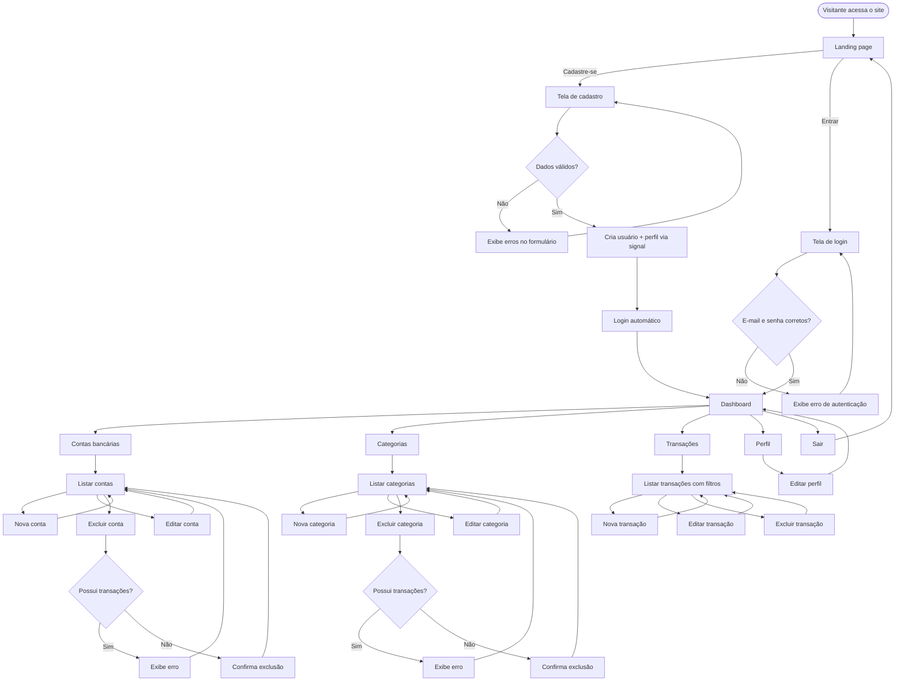
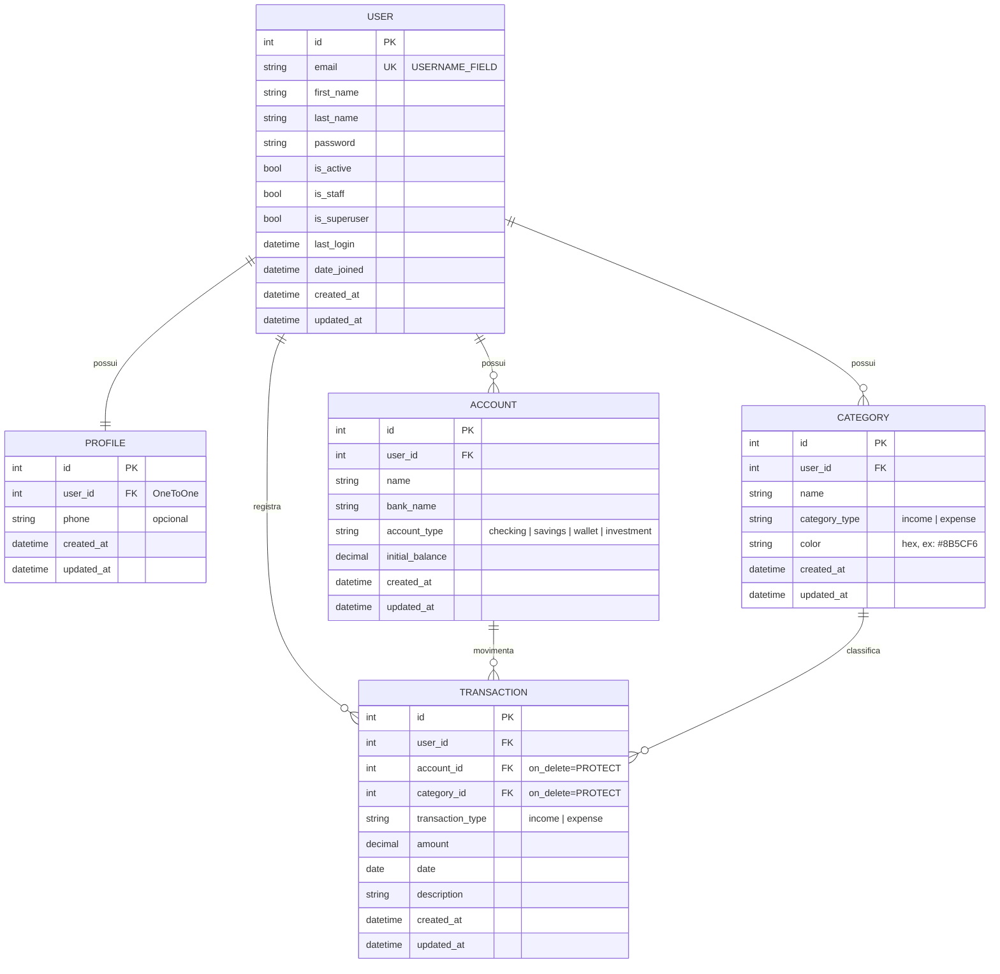

# PRD — Finanpy

> Product Requirement Document do sistema de gestão de finanças pessoais **Finanpy**.

---

## 1. Visão geral

O **Finanpy** é um sistema web de gestão de finanças pessoais, desenvolvido em Python com Django full stack. Ele permite que o usuário cadastre suas contas bancárias, organize suas movimentações financeiras por categorias e acompanhe entradas, saídas e saldos em um dashboard único.

O projeto é intencionalmente simples e enxuto: sem over engineering, usando apenas recursos nativos do Django, Django Template Language (DTL) com TailwindCSS no frontend e SQLite como banco de dados.

---

## 2. Sobre o produto

O Finanpy é composto por duas áreas:

1. **Site público de apresentação (landing page):** apresenta o produto e oferece as opções **Cadastre-se** e **Entrar**.
2. **Área autenticada:** após o login (feito por e-mail e senha), o usuário é direcionado ao **dashboard**, de onde acessa:
   - Contas bancárias
   - Categorias
   - Transações (entradas e saídas)
   - Perfil

Toda a interface é em **português brasileiro**, com design moderno, responsivo, fundo escuro e gradientes de cores harmônicas, seguindo um design system único em todas as telas.

---

## 3. Propósito

Oferecer uma ferramenta simples, rápida e visualmente agradável para que pessoas físicas controlem o próprio dinheiro: saber quanto têm, de onde vem e para onde vai cada real, sem a complexidade de planilhas ou aplicativos sobrecarregados de funcionalidades.

---

## 4. Público alvo

- Pessoas físicas que desejam organizar suas finanças pessoais.
- Usuários que possuem uma ou mais contas bancárias e querem uma visão consolidada dos saldos.
- Pessoas que hoje usam planilhas ou anotações e buscam algo mais prático.
- Perfil de uso: desktop e mobile (navegador), com conhecimento básico de internet.

---

## 5. Objetivos

1. Permitir o cadastro e login de usuários utilizando **e-mail** como identificador.
2. Permitir o gerenciamento (CRUD) de **contas bancárias**.
3. Permitir o gerenciamento (CRUD) de **categorias** de entradas e saídas.
4. Permitir o registro (CRUD) de **transações** de entrada e saída, vinculadas a uma conta e a uma categoria.
5. Exibir um **dashboard** com saldo total, total de entradas e saídas do mês e últimas transações.
6. Garantir que cada usuário acesse **somente os próprios dados**.
7. Manter uma **identidade visual consistente** em todo o sistema.
8. Manter o código **simples**, em inglês, seguindo a PEP 8 e usando aspas simples.

---

## 6. Requisitos funcionais

### 6.1 Site público

| ID   | Requisito                                                                                        |
| ---- | ------------------------------------------------------------------------------------------------ |
| RF01 | O sistema deve exibir uma landing page pública apresentando o Finanpy.                           |
| RF02 | A landing page deve conter os botões **Cadastre-se** e **Entrar**.                               |
| RF03 | Usuários já autenticados que acessarem a landing page devem ver o botão **Ir para o dashboard**. |

### 6.2 Usuários e autenticação

| ID   | Requisito                                                                                                          |
| ---- | ------------------------------------------------------------------------------------------------------------------ |
| RF04 | O usuário deve poder se cadastrar informando nome, sobrenome, e-mail e senha (com confirmação).                    |
| RF05 | O e-mail deve ser único no sistema.                                                                                |
| RF06 | O login deve ser realizado com **e-mail e senha** (não com username).                                              |
| RF07 | Após o cadastro, o usuário deve ser autenticado automaticamente e redirecionado ao dashboard.                      |
| RF08 | Após o login, o usuário deve ser redirecionado ao dashboard.                                                       |
| RF09 | O usuário deve poder sair do sistema (logout), sendo redirecionado à landing page.                                 |
| RF10 | Páginas da área autenticada devem exigir login; usuários não autenticados são redirecionados para a tela de login. |

### 6.3 Perfil

| ID   | Requisito                                                                                   |
| ---- | ------------------------------------------------------------------------------------------- |
| RF11 | Um perfil deve ser criado automaticamente quando um usuário é cadastrado.                   |
| RF12 | O usuário deve poder visualizar e editar seus dados de perfil (nome, sobrenome e telefone). |

### 6.4 Contas bancárias

| ID   | Requisito                                                                                     |
| ---- | --------------------------------------------------------------------------------------------- |
| RF13 | O usuário deve poder cadastrar contas bancárias (nome, banco, tipo de conta e saldo inicial). |
| RF14 | O usuário deve poder listar, editar e excluir suas contas.                                    |
| RF15 | O sistema deve exibir o saldo atual de cada conta (saldo inicial + entradas − saídas).        |
| RF16 | Tipos de conta disponíveis: Conta corrente, Poupança, Carteira e Investimento.                |

### 6.5 Categorias

| ID   | Requisito                                                                                            |
| ---- | ---------------------------------------------------------------------------------------------------- |
| RF17 | O usuário deve poder cadastrar categorias informando nome, tipo (Entrada ou Saída) e cor.            |
| RF18 | O usuário deve poder listar, editar e excluir suas categorias.                                       |
| RF19 | Uma categoria vinculada a transações não pode ser excluída (o sistema deve exibir mensagem de erro). |

### 6.6 Transações

| ID   | Requisito                                                                                                             |
| ---- | --------------------------------------------------------------------------------------------------------------------- |
| RF20 | O usuário deve poder registrar transações informando tipo (Entrada/Saída), valor, data, descrição, conta e categoria. |
| RF21 | O usuário deve poder listar, editar e excluir suas transações.                                                        |
| RF22 | A listagem de transações deve ser ordenada da mais recente para a mais antiga e paginada.                             |
| RF23 | A listagem deve permitir filtro por período (data inicial e final), tipo, conta e categoria.                          |
| RF24 | Nos formulários, apenas contas e categorias do próprio usuário devem ser exibidas.                                    |
| RF25 | A categoria escolhida deve ser do mesmo tipo da transação (Entrada/Saída).                                            |
| RF26 | Uma conta vinculada a transações não pode ser excluída (o sistema deve exibir mensagem de erro).                      |

### 6.7 Dashboard

| ID   | Requisito                                                                |
| ---- | ------------------------------------------------------------------------ |
| RF27 | O dashboard deve exibir o saldo total consolidado de todas as contas.    |
| RF28 | O dashboard deve exibir o total de entradas e de saídas do mês corrente. |
| RF29 | O dashboard deve exibir o resultado do mês (entradas − saídas).          |
| RF30 | O dashboard deve exibir as 5 últimas transações.                         |
| RF31 | O dashboard deve exibir a lista de contas com seus saldos.               |

### 6.8 Mensagens de feedback

| ID   | Requisito                                                                                                     |
| ---- | ------------------------------------------------------------------------------------------------------------- |
| RF32 | Toda ação de criar, editar e excluir deve exibir uma mensagem de sucesso ou erro (Django messages framework). |

### 6.9 Flowchart dos fluxos de UX



---

## 7. Requisitos não-funcionais

| ID    | Requisito                                                                                                                       |
| ----- | ------------------------------------------------------------------------------------------------------------------------------- |
| RNF01 | Backend e frontend em **Django full stack**, com templates em Django Template Language.                                         |
| RNF02 | Estilização exclusivamente com **TailwindCSS**.                                                                                 |
| RNF03 | Interface **responsiva** (mobile, tablet e desktop), com fundo escuro e gradientes.                                             |
| RNF04 | Toda a interface exibida ao usuário em **português brasileiro** (`LANGUAGE_CODE = 'pt-br'`, `TIME_ZONE = 'America/Sao_Paulo'`). |
| RNF05 | Todo o código (variáveis, funções, classes, models, URLs) em **inglês**.                                                        |
| RNF06 | Código seguindo a **PEP 8** e usando **aspas simples** sempre que possível.                                                     |
| RNF07 | Banco de dados **SQLite** padrão do Django.                                                                                     |
| RNF08 | Todo model deve possuir os campos `created_at` e `updated_at`.                                                                  |
| RNF09 | Uso preferencial de **Class Based Views** e recursos nativos do Django.                                                         |
| RNF10 | Signals, quando usados, ficam em `signals.py` dentro da app correspondente.                                                     |
| RNF11 | Autenticação com o sistema nativo do Django (`django.contrib.auth`), com login por e-mail.                                      |
| RNF12 | Isolamento de dados: todas as queries da área autenticada filtradas pelo usuário logado.                                        |
| RNF13 | Proteção CSRF em todos os formulários (nativa do Django).                                                                       |
| RNF14 | Senhas validadas pelos `AUTH_PASSWORD_VALIDATORS` nativos do Django.                                                            |
| RNF15 | Valores monetários armazenados em `DecimalField` e exibidos no formato brasileiro (R$ 1.234,56).                                |
| RNF16 | Testes automatizados e Docker ficam para as sprints finais.                                                                     |

---

## 8. Arquitetura técnica

### 8.1 Stack

| Camada                    | Tecnologia                                                                |
| ------------------------- | ------------------------------------------------------------------------- |
| Linguagem                 | Python 3.12+                                                              |
| Framework                 | Django 5.x                                                                |
| Templates                 | Django Template Language                                                  |
| Estilos                   | TailwindCSS (CLI standalone, sem Node.js)                                 |
| Banco de dados            | SQLite                                                                    |
| Autenticação              | `django.contrib.auth` com model de usuário customizado (login por e-mail) |
| Mensagens                 | `django.contrib.messages`                                                 |
| Formatação BR             | `django.contrib.humanize` + localização nativa (`USE_L10N`/`pt-br`)       |
| Containers (sprint final) | Docker + docker-compose                                                   |
| Testes (sprint final)     | `django.test` (TestCase nativo)                                           |

### 8.2 Estrutura de diretórios

```
finanpy
├── accounts          # contas bancárias
├── categories        # categorias de lançamentos/transações
├── core              # configurações globais, landing page e dashboard
├── profiles          # perfis de usuários (+ signals.py)
├── transactions      # transações - entradas e saídas
├── users             # usuário customizado (login por e-mail)
├── templates         # templates globais (base, componentes, landing)
│   ├── base.html
│   ├── base_auth.html
│   ├── components/
│   └── ...
├── static
│   ├── css/input.css
│   └── css/output.css
├── db.sqlite3
└── manage.py
```

Cada app possui sua própria pasta `templates/<app>/` para os templates específicos, além de `urls.py` e `forms.py` quando necessário.

### 8.3 Responsabilidade das apps

| App            | Responsabilidade                                                                  |
| -------------- | --------------------------------------------------------------------------------- |
| `core`         | settings, URLs raiz, landing page (`HomeView`) e dashboard (`DashboardView`)      |
| `users`        | model `User` customizado (e-mail como `USERNAME_FIELD`), cadastro, login e logout |
| `profiles`     | model `Profile`, signal de criação automática e edição de perfil                  |
| `accounts`     | model `Account` e CRUD de contas                                                  |
| `categories`   | model `Category` e CRUD de categorias                                             |
| `transactions` | model `Transaction`, CRUD e filtros                                               |

### 8.4 Estrutura de dados (schemas)



**Observações de modelagem:**

- `User` herda de `AbstractUser`, remove o campo `username`, define `email` como único e `USERNAME_FIELD = 'email'`, com um `UserManager` customizado.
- O saldo atual da conta **não é armazenado**: é calculado (`initial_balance + soma de entradas − soma de saídas`) via método/propriedade no model, evitando inconsistências.
- `account` e `category` em `Transaction` usam `on_delete=models.PROTECT`, impedindo exclusão de registros em uso.
- `Category` possui `unique_together` (ou `UniqueConstraint`) em `(user, name, category_type)`.
- `amount` e `initial_balance` usam `DecimalField(max_digits=12, decimal_places=2)`; `amount` deve ser maior que zero.
- `created_at = models.DateTimeField(auto_now_add=True)` e `updated_at = models.DateTimeField(auto_now=True)` em todos os models.

---

## 9. Design system

Todo o visual é construído com classes utilitárias do TailwindCSS dentro dos templates DTL. Componentes reutilizáveis ficam em `templates/components/` e são incluídos com ``.

### 9.1 Princípios

- **Fundo escuro** como base, com superfícies levemente mais claras para criar profundidade.
- **Gradiente de marca** (violeta → índigo → ciano) aplicado em destaques: logo, botões primários, títulos de hero e cards de destaque.
- **Cores semânticas** consistentes: verde para entradas, vermelho/rosa para saídas.
- **Cantos arredondados**, bordas sutis e sombras suaves.
- **Mobile first**: todo layout começa em uma coluna e expande em breakpoints `md` e `lg`.

### 9.2 Paleta de cores

| Token              | Uso                         | Classe Tailwind             | Hex                   |
| ------------------ | --------------------------- | --------------------------- | --------------------- |
| Fundo da página    | `body`                      | `bg-slate-950`              | `#020617`             |
| Superfície         | cards, sidebar, navbar      | `bg-slate-900`              | `#0F172A`             |
| Superfície elevada | inputs, hover de itens      | `bg-slate-800`              | `#1E293B`             |
| Borda              | divisórias e contornos      | `border-slate-700/50`       | `#334155`             |
| Texto principal    | títulos e valores           | `text-slate-100`            | `#F1F5F9`             |
| Texto secundário   | descrições e labels         | `text-slate-400`            | `#94A3B8`             |
| Primária           | ações e foco                | `violet-500` / `violet-600` | `#8B5CF6` / `#7C3AED` |
| Secundária         | apoio do gradiente          | `indigo-500`                | `#6366F1`             |
| Acento             | apoio do gradiente          | `cyan-400`                  | `#22D3EE`             |
| Entrada (sucesso)  | valores positivos           | `emerald-400`               | `#34D399`             |
| Saída (perigo)     | valores negativos, exclusão | `rose-400` / `rose-600`     | `#FB7185` / `#E11D48` |
| Alerta             | avisos                      | `amber-400`                 | `#FBBF24`             |

**Gradientes:**

| Nome                      | Classes                                                                                     |
| ------------------------- | ------------------------------------------------------------------------------------------- |
| Gradiente de marca        | `bg-gradient-to-r from-violet-600 via-indigo-500 to-cyan-400`                               |
| Gradiente de texto        | `bg-gradient-to-r from-violet-400 via-indigo-400 to-cyan-300 bg-clip-text text-transparent` |
| Gradiente de fundo (hero) | `bg-gradient-to-br from-slate-950 via-indigo-950 to-slate-950`                              |
| Card de entrada           | `bg-gradient-to-br from-emerald-500/20 to-emerald-500/5`                                    |
| Card de saída             | `bg-gradient-to-br from-rose-500/20 to-rose-500/5`                                          |

### 9.3 Tipografia

- **Fonte:** `Inter` (Google Fonts), com fallback `ui-sans-serif, system-ui, sans-serif`, configurada como `font-sans` no tema do Tailwind.
- **Valores monetários:** `tabular-nums` para alinhar dígitos.

| Elemento              | Classes                                                      |
| --------------------- | ------------------------------------------------------------ |
| Título da página (h1) | `text-2xl md:text-3xl font-bold text-slate-100`              |
| Título de seção (h2)  | `text-xl font-semibold text-slate-100`                       |
| Título de card (h3)   | `text-sm font-medium text-slate-400 uppercase tracking-wide` |
| Valor de destaque     | `text-2xl md:text-3xl font-bold tabular-nums`                |
| Texto padrão          | `text-sm text-slate-300`                                     |
| Texto auxiliar        | `text-xs text-slate-500`                                     |
| Título hero (landing) | `text-4xl md:text-6xl font-extrabold` + gradiente de texto   |

### 9.4 Botões

Base comum: `inline-flex items-center justify-center gap-2 rounded-xl px-4 py-2.5 text-sm font-semibold transition focus:outline-none focus:ring-2 focus:ring-violet-500 focus:ring-offset-2 focus:ring-offset-slate-950`

| Variante   | Classes adicionais                                                                                                       | Uso                      |
| ---------- | ------------------------------------------------------------------------------------------------------------------------ | ------------------------ |
| Primário   | `bg-gradient-to-r from-violet-600 via-indigo-500 to-cyan-400 text-white shadow-lg shadow-violet-900/30 hover:opacity-90` | Salvar, criar, entrar    |
| Secundário | `bg-slate-800 text-slate-100 border border-slate-700 hover:bg-slate-700`                                                 | Cancelar, voltar         |
| Perigo     | `bg-rose-600 text-white hover:bg-rose-500`                                                                               | Confirmar exclusão       |
| Ghost      | `text-slate-300 hover:text-white hover:bg-slate-800`                                                                     | Ações de tabela, links   |
| Ícone      | `p-2 rounded-lg text-slate-400 hover:text-white hover:bg-slate-800`                                                      | Editar/excluir em linhas |

### 9.5 Inputs e forms

| Elemento                  | Classes                                                                                                                                                                                    |
| ------------------------- | ------------------------------------------------------------------------------------------------------------------------------------------------------------------------------------------ |
| Label                     | `block text-sm font-medium text-slate-300 mb-1.5`                                                                                                                                          |
| Input / select / textarea | `w-full rounded-xl bg-slate-800 border border-slate-700 px-4 py-2.5 text-slate-100 placeholder-slate-500 focus:border-violet-500 focus:ring-2 focus:ring-violet-500/40 focus:outline-none` |
| Input com erro            | adicionar `border-rose-500 focus:ring-rose-500/40`                                                                                                                                         |
| Mensagem de erro          | `mt-1 text-xs text-rose-400`                                                                                                                                                               |
| Texto de ajuda            | `mt-1 text-xs text-slate-500`                                                                                                                                                              |
| Container do form         | `bg-slate-900 border border-slate-700/50 rounded-2xl p-6 md:p-8 space-y-5`                                                                                                                 |
| Rodapé do form            | `flex flex-col-reverse sm:flex-row sm:justify-end gap-3 pt-4`                                                                                                                              |

As classes dos inputs são aplicadas nos `widgets` dos forms Django (atributo `attrs={'class': ...}`), centralizadas em um mixin/constante reutilizável para não repetir strings. Os campos são renderizados pelo componente `components/form_field.html`.

### 9.6 Cards

| Elemento                       | Classes                                                                                                             |
| ------------------------------ | ------------------------------------------------------------------------------------------------------------------- |
| Card padrão                    | `bg-slate-900 border border-slate-700/50 rounded-2xl p-6 shadow-xl shadow-black/20`                                 |
| Card de métrica (KPI)          | card padrão + gradiente semântico e ícone                                                                           |
| Card de destaque (saldo total) | `rounded-2xl p-6 bg-gradient-to-br from-violet-600/30 via-indigo-600/20 to-cyan-500/10 border border-violet-500/30` |

### 9.7 Grids e layout

| Contexto             | Classes                                                            |
| -------------------- | ------------------------------------------------------------------ |
| Container da página  | `max-w-7xl mx-auto px-4 sm:px-6 lg:px-8 py-6`                      |
| Grid de KPIs         | `grid grid-cols-1 sm:grid-cols-2 lg:grid-cols-4 gap-4`             |
| Grid de duas colunas | `grid grid-cols-1 lg:grid-cols-3 gap-6` (conteúdo `lg:col-span-2`) |
| Grid de formulário   | `grid grid-cols-1 md:grid-cols-2 gap-5`                            |
| Layout autenticado   | sidebar fixa à esquerda (`lg:w-64`) + conteúdo `flex-1`            |

### 9.8 Menus e navegação

- **Navbar pública (landing):** `sticky top-0 backdrop-blur bg-slate-950/70 border-b border-slate-800`; logo com gradiente à esquerda; botões **Entrar** (ghost) e **Cadastre-se** (primário) à direita.
- **Sidebar autenticada (desktop, `lg+`):** `bg-slate-900 border-r border-slate-800`, itens:
  - Dashboard, Contas, Categorias, Transações, Perfil, Sair.
  - Item padrão: `flex items-center gap-3 px-4 py-2.5 rounded-xl text-slate-400 hover:text-white hover:bg-slate-800`
  - Item ativo: `bg-gradient-to-r from-violet-600/20 to-transparent text-white border-l-2 border-violet-500`
- **Menu mobile:** topbar com botão hambúrguer que abre/fecha a sidebar (toggle com poucas linhas de JavaScript puro, sem bibliotecas).

### 9.9 Tabelas e listas

| Elemento         | Classes                                                                                         |
| ---------------- | ----------------------------------------------------------------------------------------------- |
| Wrapper          | `overflow-x-auto rounded-2xl border border-slate-700/50`                                        |
| Tabela           | `min-w-full divide-y divide-slate-800 text-sm`                                                  |
| Cabeçalho        | `bg-slate-900 text-left text-xs font-semibold uppercase tracking-wide text-slate-400 px-4 py-3` |
| Linha            | `bg-slate-900/50 hover:bg-slate-800/60 transition`                                              |
| Célula           | `px-4 py-3 text-slate-300`                                                                      |
| Valor de entrada | `text-emerald-400 font-semibold tabular-nums` (prefixo `+`)                                     |
| Valor de saída   | `text-rose-400 font-semibold tabular-nums` (prefixo `−`)                                        |

No mobile, listas longas podem ser exibidas como cards empilhados em vez de tabela (`hidden md:table` / `md:hidden`).

### 9.10 Badges, alertas e estados

| Elemento           | Classes                                                                                         |
| ------------------ | ----------------------------------------------------------------------------------------------- |
| Badge entrada      | `inline-flex px-2.5 py-0.5 rounded-full text-xs font-medium bg-emerald-500/15 text-emerald-400` |
| Badge saída        | `inline-flex px-2.5 py-0.5 rounded-full text-xs font-medium bg-rose-500/15 text-rose-400`       |
| Badge de categoria | bolinha com a cor da categoria (`style="background-color: {{ category.color }}"`) + nome        |
| Alerta sucesso     | `rounded-xl border border-emerald-500/30 bg-emerald-500/10 text-emerald-300 px-4 py-3`          |
| Alerta erro        | `rounded-xl border border-rose-500/30 bg-rose-500/10 text-rose-300 px-4 py-3`                   |
| Estado vazio       | card centralizado com ícone, texto `text-slate-400` e botão primário de criação                 |

### 9.11 Componentes de template

| Arquivo                                    | Descrição                                                     |
| ------------------------------------------ | ------------------------------------------------------------- |
| `templates/base.html`                      | HTML base: fonte, CSS do Tailwind, bloco `content`, mensagens |
| `templates/base_auth.html`                 | Estende `base.html` com sidebar + topbar mobile               |
| `templates/components/navbar_public.html`  | Navbar da landing e telas de login/cadastro                   |
| `templates/components/sidebar.html`        | Menu lateral da área autenticada                              |
| `templates/components/messages.html`       | Alertas do messages framework                                 |
| `templates/components/form_field.html`     | Label + campo + erro + ajuda                                  |
| `templates/components/page_header.html`    | Título da página + botão de ação                              |
| `templates/components/empty_state.html`    | Estado vazio de listagens                                     |
| `templates/components/pagination.html`     | Paginação padrão                                              |
| `templates/components/confirm_delete.html` | Tela de confirmação de exclusão                               |
| `templates/components/kpi_card.html`       | Card de métrica do dashboard                                  |

---

## 10. User stories

### Épico 1 — Site público e autenticação

**US01 — Conhecer o produto**
Como visitante, quero ver uma página de apresentação do Finanpy, para entender o que o sistema oferece antes de me cadastrar.

- [ ] A landing page é acessível sem login.
- [ ] Exibe título, descrição do produto e seção de benefícios.
- [ ] Exibe os botões **Cadastre-se** e **Entrar**, que levam às telas corretas.
- [ ] É responsiva e segue o design system.

**US02 — Criar conta**
Como visitante, quero me cadastrar com nome, e-mail e senha, para começar a usar o sistema.

- [ ] O formulário solicita nome, sobrenome, e-mail, senha e confirmação de senha.
- [ ] E-mail já cadastrado exibe erro "Já existe um usuário com este e-mail."
- [ ] Senhas diferentes ou fracas exibem erro em português.
- [ ] Após o cadastro, o usuário é logado e redirecionado ao dashboard.
- [ ] Um perfil é criado automaticamente.

**US03 — Entrar no sistema**
Como usuário, quero entrar com meu e-mail e senha, para acessar meus dados.

- [ ] O formulário solicita e-mail e senha (não username).
- [ ] Credenciais inválidas exibem "E-mail ou senha inválidos."
- [ ] Após o login, o usuário é redirecionado ao dashboard.

**US04 — Sair do sistema**
Como usuário, quero sair da minha conta, para proteger meus dados.

- [ ] A opção **Sair** está disponível no menu.
- [ ] O logout é feito via POST e redireciona à landing page.

### Épico 2 — Perfil

**US05 — Editar meu perfil**
Como usuário, quero editar meu nome, sobrenome e telefone.

- [ ] A tela de perfil exibe os dados atuais preenchidos.
- [ ] Ao salvar, exibe "Perfil atualizado com sucesso."
- [ ] O e-mail é exibido, mas não editável.

### Épico 3 — Contas bancárias

**US06 — Cadastrar conta**
Como usuário, quero cadastrar minhas contas bancárias com saldo inicial.

- [ ] O formulário pede nome, banco, tipo e saldo inicial.
- [ ] A conta fica vinculada ao usuário logado.
- [ ] Exibe mensagem de sucesso e redireciona para a listagem.

**US07 — Gerenciar contas**
Como usuário, quero listar, editar e excluir minhas contas e ver o saldo atual de cada uma.

- [ ] A listagem mostra nome, banco, tipo e saldo atual em R$.
- [ ] Só são exibidas contas do usuário logado; acessar conta de outro usuário retorna 404.
- [ ] A exclusão pede confirmação.
- [ ] Conta com transações não pode ser excluída e exibe mensagem de erro.
- [ ] Sem contas cadastradas, exibe estado vazio com botão "Nova conta".

### Épico 4 — Categorias

**US08 — Gerenciar categorias**
Como usuário, quero criar, listar, editar e excluir categorias de entrada e saída, para organizar minhas transações.

- [ ] O formulário pede nome, tipo (Entrada/Saída) e cor.
- [ ] Não é possível duplicar nome + tipo para o mesmo usuário.
- [ ] A listagem separa ou identifica visualmente entradas e saídas.
- [ ] Categoria com transações não pode ser excluída e exibe mensagem de erro.
- [ ] Só são exibidas categorias do usuário logado.

### Épico 5 — Transações

**US09 — Registrar transação**
Como usuário, quero registrar entradas e saídas com valor, data, descrição, conta e categoria.

- [ ] O valor deve ser maior que zero.
- [ ] Os selects exibem apenas contas e categorias do usuário.
- [ ] A categoria deve ser do mesmo tipo da transação; caso contrário, exibe erro.
- [ ] A data vem preenchida com o dia atual.
- [ ] Após salvar, o saldo da conta reflete a transação.

**US10 — Consultar transações**
Como usuário, quero listar e filtrar minhas transações, para analisar meus gastos e receitas.

- [ ] A listagem é ordenada da mais recente para a mais antiga.
- [ ] Possui paginação (20 itens por página).
- [ ] Permite filtrar por período, tipo, conta e categoria, mantendo os filtros na paginação.
- [ ] Entradas aparecem em verde e saídas em vermelho.

**US11 — Editar e excluir transação**
Como usuário, quero corrigir ou remover transações lançadas.

- [ ] A edição aplica as mesmas validações do cadastro.
- [ ] A exclusão pede confirmação e exibe mensagem de sucesso.
- [ ] Transações de outro usuário retornam 404.

### Épico 6 — Dashboard

**US12 — Visão geral das finanças**
Como usuário, quero ver um resumo das minhas finanças ao entrar no sistema.

- [ ] Exibe saldo total consolidado.
- [ ] Exibe total de entradas, total de saídas e resultado do mês corrente.
- [ ] Exibe as 5 últimas transações com link para a listagem completa.
- [ ] Exibe a lista de contas com saldos.
- [ ] Sem dados, exibe estados vazios orientando o usuário a cadastrar contas e transações.

---

## 11. Métricas de sucesso

### 11.1 KPIs de produto

| KPI                                                                               | Meta                 |
| --------------------------------------------------------------------------------- | -------------------- |
| Taxa de conversão landing → cadastro                                              | ≥ 10% dos visitantes |
| Taxa de ativação (usuário que cadastra ao menos 1 conta e 1 transação em até 24h) | ≥ 60%                |
| Tempo médio para registrar uma transação                                          | ≤ 30 segundos        |
| Erros 500 em produção                                                             | 0                    |

### 11.2 KPIs de usuário

| KPI                                                       | Meta  |
| --------------------------------------------------------- | ----- |
| Retenção semanal (usuários que voltam na semana seguinte) | ≥ 40% |
| Média de transações registradas por usuário ativo/mês     | ≥ 20  |
| Média de contas cadastradas por usuário                   | ≥ 2   |
| Média de categorias personalizadas por usuário            | ≥ 5   |

### 11.3 KPIs técnicos

| KPI                                    | Meta     |
| -------------------------------------- | -------- |
| Tempo de resposta das páginas          | ≤ 500 ms |
| Conformidade com PEP 8 (flake8/ruff)   | 100%     |
| Cobertura de testes (sprint de testes) | ≥ 80%    |
| Telas seguindo o design system         | 100%     |

---

## 12. Riscos e mitigações

| Risco                                                | Impacto | Mitigação                                                                                             |
| ---------------------------------------------------- | ------- | ----------------------------------------------------------------------------------------------------- |
| Usuário acessar dados de outro usuário               | Alto    | Filtrar todos os querysets por `request.user` via mixin; `get_object_or_404` sobre queryset filtrado. |
| Troca do model de usuário após migrations criadas    | Alto    | Criar o `User` customizado e definir `AUTH_USER_MODEL` **antes** da primeira migration.               |
| Saldo inconsistente                                  | Médio   | Calcular saldo dinamicamente a partir das transações, sem armazenar valor derivado.                   |
| Exclusão de conta/categoria apagar histórico         | Alto    | `on_delete=PROTECT` e tratamento de `ProtectedError` com mensagem amigável.                           |
| Erros de arredondamento em valores                   | Médio   | Usar `DecimalField`, nunca `float`.                                                                   |
| Inconsistência visual entre telas                    | Médio   | Componentes de template reutilizáveis e constantes de classes CSS para widgets.                       |
| CSS do Tailwind não gerado em produção               | Médio   | Documentar comando de build e versionar/gerar `output.css` no deploy; incluir no Dockerfile.          |
| Escopo crescer além do necessário (over engineering) | Médio   | Seguir estritamente este PRD; novas funcionalidades só com nova aprovação.                            |
| SQLite com limitação de concorrência                 | Baixo   | Adequado ao porte do projeto; reavaliar banco apenas se houver necessidade real.                      |
| Ausência de testes nas sprints iniciais              | Médio   | Validação manual ao fim de cada sprint; sprint dedicada a testes antes do Docker.                     |

---
